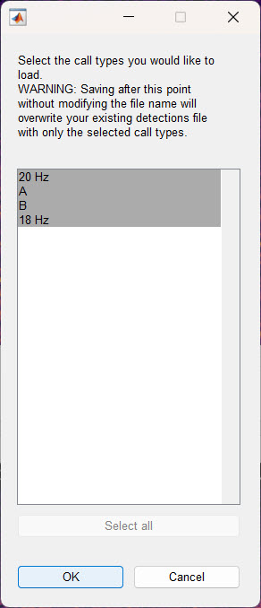
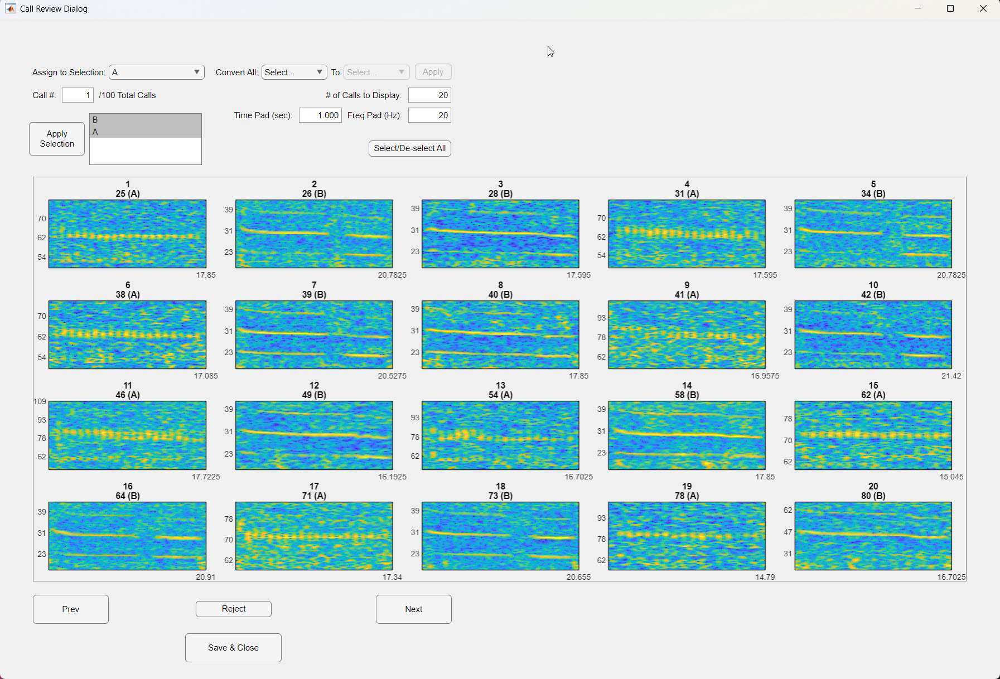

Once your annotations or detections are in a DeepAcoustics detections file, you can review them to correct labels, accept or reject calls, and weed out false positives. DeepAcoustics offers two ways to do this: reviewing calls one at a time in the main window, or batch reviewing many calls at once with the **Call Review** tool. The examples on this page use a multiclass detections file containing both blue whale (A and B) and fin whale (18 Hz and 20 Hz) calls.

------------------------------------------------------------------------

### Reviewing Calls in the Main Window

#### Loading a multiclass detections file

1.  **Load the detections.** Go to **File \> Load Detections** and select your detections file. Because this file contains more than one call type, a dialog lists the available call types and asks which ones to load.

2.  **Select all call types.** In most cases, click **Select all** and then **OK**. You can still limit what is displayed afterward with **Filter Display** (see below), without risking the loss of any calls when you save.

    

3.  **Choose a starting audio file.** Select the first audio file in the dataset (or wherever you want to begin) and click **OK**.

::: callout-important
#### Loading only some call types affects what is saved

If you load only some of the call types and then save the session under the same file name, DeepAcoustics overwrites the original file and **the call types you did not load are discarded**. Loading all call types and using **Filter Display** avoids this.

You can also use this behavior on purpose. For example, to create a file containing only A calls, load only the A calls and then save the session under a **new** file name. The new file contains only A calls, and the original file is left unchanged.
:::

#### Filtering the display

In the **Detect, Load, & Record** section, select **Filter Display** to choose which call types are shown. For example, select only **A** and **B** to display just the blue whale calls in the file. The other call types stay in the file; they are only hidden from view. To show everything again, select **Filter Display** and choose all call types. Filtering is a convenient way to review a multiclass file one call type at a time.

#### Reviewing individual calls

The main window is set up for reviewing calls one at a time, for example to work through a network's detections and sort true detections from false positives. The currently selected call is shown with a bolder, highlighted box in the spectrogram. The controls in the **Annotation & Detection** section all act on that call, and each has a keyboard shortcut so you can move quickly:

- **Accept Call (a):** accepts the selected call and moves straight to the next one. To review a set of detections quickly, press **a** for each call that is correct.
- **Reject Call (r):** rejects the selected call, relabels it as **Noise**, and moves to the next one. Use it for false positives as you work through the file.
- **Play Call (p):** plays the audio inside the selected call's box, at the rate set by **Change Playback Rate** in the File menu.
- **Draw (d):** draws a new box, for example to add a call the network missed (see [Preparing Your Data](prep.qmd)).
- **Draw Label:** sets the label used for new boxes and for relabeling.
- **Re-Label (w):** changes the label of the selected call to the label shown next to **Draw Label**. Select **Draw Label** first to choose the correct label.



::: callout-warning
#### Accepting a call can also change its label

If a call has not already been accepted, **Accept Call (a)** also changes its label to the one currently shown next to **Draw Label**. Before accepting calls, make sure **Draw Label** is set to the correct call type, or calls may be relabeled without you noticing.
:::

When you finish, select **Save Session**. If you made changes and want to keep the original file intact, save under a new file name.

------------------------------------------------------------------------

### Batch Review with Call Review

The **Call Review** tool displays many calls at once as a grid of small spectrograms, so you can scan through a detections file quickly. It is especially useful for finding and removing false positives from a network's detections.

#### Opening Call Review

1.  **Open the tool.** Go to **Tools \> Call Review**.
2.  **Select the detections file.** Choose the detections `.mat` file you want to review. Call Review opens the file directly, so it does not need to be loaded in the main window first.
3.  **Choose the call types to review.** In the list on the left, select the call type(s) you want to see and click **Apply Selection**. Hold **Ctrl** to select more than one call type.

{fig-align="center" width="619"}

#### Call Review settings

- **\# of Calls to Display:** how many calls are shown on each page of the grid (for example, 20).
- **Time Pad (sec):** extra time added before and after each call, in seconds, so you can see the call in context (for example, 1 second on either side).
- **Freq Pad (Hz):** extra frequency range added above and below each call, in Hz (for example, 20 Hz), to frame the call better.
- **Call #:** the number of the first call shown. Type a number to jump to that call. The total number of calls of the selected type(s) is shown beside it.
- **Prev and Next:** move back or forward one page of calls.

Each spectrogram in the grid is titled with its position on the page, followed by the call's ID number and its current label in parentheses.

1.  **Select calls.** Click a spectrogram to select it; selected calls appear faded. Click it again to deselect it. You can select as many calls as you like, or use **Select/De-select All** to select or clear every call on the page.
2.  **Change the label of selected calls.** Choose a label from **Assign to Selection**. The new label is applied to the selected calls immediately. Choose **Add New Call Type** to create a new label.
3.  **Reject selected calls.** Select **Reject** to relabel the selected calls as **Noise**.
4.  **Convert an entire call type.** Use **Convert All** to change every call of one type to another type in a single step. Choose the current type, choose the new type in **To**, and click **Apply**. This applies to all calls of that type in the file, not just those on the current page.



#### Saving your review

When you are finished, select **Save & Close**. DeepAcoustics asks where to save the reviewed detections file.

::: callout-important
If you made changes and want to keep the original file intact, save under a new file name. Saving under the same name updates the existing file with your changes. If you cancel the save dialog, the changes made in Call Review are not saved.
:::

You can then return to the main window, load the reviewed file, and use **Filter Display** to step through each call type for a final check.
