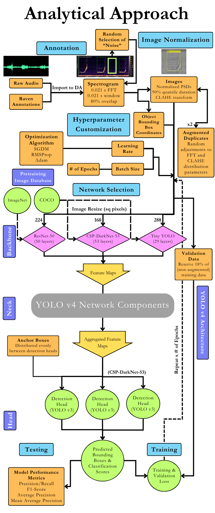

------------------------------------------------------------------------

### The Rise of Image-Based Deep Learning in Bioacoustics

The networks and image libraries fueled by image-based deep learning advancements in a variety of industries have allowed image-based approaches to bioacoustic detection and classification to grow extensively to address first terrestrial, and then marine monitoring needs (Kahl et al., 2021; Ghani et al., 2023; Harvey et al., 2024; Hamard et al., 2024). Image-based deep learning methods generally fall within either a binary classification or object detection framework. Binary classification aims to determine whether a specific class of object exists anywhere within an image, whereas object detection, usually leveraging a "You Only Look Once" (YOLO) deep learning architecture, further attempts to locate the object within the image. Both approaches output a class label and confidence score, but in the former these apply to the entire image being analyzed, while in the latter they correspond to a bounding box delineating the signal within the image (Krizhevsky et al., 2012; Redmon et al., 2016; Coffey et al., 2019; Shiu et al., 2020). For binary classification tasks, this means that the duration of the audio data used to create the training images must be carefully chosen to frame the signal(s) of interest, and achieving precise temporal resolution of the signals of interest requires processing multiple overlapping images. In object detection, these factors are mitigated through the use of tiling anchor boxes intrinsic in object detection approaches (which effectively function as binary classification models of different sizes and aspect ratios; Amit et al., 2021), which also allows a multi-class approach to signals of varying duration within the same spectrogram (Escobar-Amado et al., 2023; Hamard et al., 2024; Alksne et al., 2026).

Traditional marine acoustic signal processing methods are often quite successful at detecting singular, specific call types (e.g., Mellinger and Clark, 2000; Gillespie et al., 2013). The challenge with many of these algorithms lies in decreased success when applied to highly variable and noisy acoustic environments or to multiple signals of interest simultaneously (Gillespie et al., 2013). Recent performance metrics for deep learning methodologies indicate high levels of detection and consistently low false positive rates. For instance, Padovese et al. (2023) reported a recall of North Atlantic right whale upcalls of 85% and fewer than five false positives per hour. Additionally, the methods used by Kather et al. (2024) for humpback whale detection resulted in an hourly F1-Score of 0.89 with only 5% of context windows labeled incorrectly and a false positive rate of 0.01 per hour. Alksne et al. (2026) obtained further success with multi-class networks for low frequency baleen whales amid variable soundscape conditions. Our research approach to multi-class networks with DeepAcoustics mirrored these low false positive, consistent classification results as well (Alongi et al., in review). These deep learning performance ratings translate to increased capabilities in processing large, highly diverse passive acoustic datasets.

------------------------------------------------------------------------

### Deep Learning Methods

Recent developments in deep learning approaches to detection and classification of signals from some species have proven successful at accurately detecting calls using trained models in varying noise conditions. Deep learning methods of detection and classification are increasing in utility within the underwater acoustic community (Allen et al., 2021; Shui et al., 2020; Vickers et al., 2021). Deep neural networks use automated means of spectrogram image classification that perform well when using an appropriately trained model. By means of rapid automated detection independent of operator experience, deep learning methods have the potential to minimize the drudgery of processing passive acoustic data, leading to more timely use of this information in research studies or biodiversity monitoring projects.

A variety of signal processing, pattern recognition and machine learning techniques have improved detection and classification of marine mammal sounds through automation, but vary with respect to performance level (Usman, et al., 2020). Deep learning models are a form of machine learning that applies different filter banks at different scales and determines features used to discriminate signals during a learning stage (Bianco, et al., 2019). The models are thus not reliant on meeting criteria for a series of target values, but rather independently determine important features using one of several neural networks. Several studies report high percentages of precision and recall, and improved performance when testing involved multiple datasets collected in variable acoustic conditions (Kirsebom, et al., 2020; Shiu et al., 2020). In addition to improved detection, deep neural networks offer capabilities in classifying marine mammal vocalizations, allowing for their use with multi-species analyses (Thomas et al., 2019).

------------------------------------------------------------------------

### Image-based Object Detection

Image-based object detection methods in bioacoustics leverage spectrograms generated from audio recordings as input for deep learning networks to detect specific calls or signals of interest, such as dolphin whistles. In this process, spectrograms undergo normalization and contrast enhancement to help the model distinguish between calls and background noise. As outlined in Fig. 1, annotations from the audio files are converted into image datastores, which are then used for object detection models in MATLAB. The duration of each spectrogram image is user-defined, with the segment length based on the duration and properties of the target calls of interest. Each spectrogram image is linked to coordinates that identify the location of calls within the image.

To help the model understand not just calls but also noise, spectrograms from audio segments without calls are also used. In these cases, random coordinates mimicking call-like features are applied to these images, allowing the model to learn the characteristics of "Noise" signals. This enables the network to better differentiate between calls and non-call elements in the spectrograms.

Further refinement of the spectrograms is achieved through contrast-limited adaptive histogram equalization (CLAHE), which enhances the contrast and normalizes the power spectral densities. Additional variability is introduced by augmenting the spectrograms, adjusting parameters like the Fast-Fourier Transform (FFT) size and overlap. The resulting images are then resized to meet the specific input requirements of the object detection networks, based on available computational resources (Table II). This approach ensures the networks are trained on a diverse range of signals, improving their ability to detect calls across different acoustic environments.

{fig-alt="DeepAcoustics flow chart" fig-align="center" width="584"}

------------------------------------------------------------------------

### YOLO Method of Object-Detection

YOLO (You Only Look Once) is a real-time object detection algorithm that has gained significant attention for its speed and accuracy in identifying objects within images. Unlike traditional methods that use sliding windows or region proposals to detect objects, YOLO treats object detection as a single regression problem, predicting both the class and the bounding box coordinates in a single pass through the network. This streamlined approach allows YOLO to process images much faster, making it well-suited for tasks requiring real-time detection. The algorithm divides the input image into a grid and assigns each grid cell the responsibility of detecting an object if its center falls within that cell. By generating predictions for multiple bounding boxes and their associated confidence scores in one forward pass, YOLO can efficiently detect objects at various scales and positions within the image.

In the context of bioacoustics, YOLO can be adapted to detect specific sounds within spectrogram images. These spectrograms serve as visual representations of sound, and YOLO is trained to recognize the distinct patterns that correspond to specific calls. The model’s ability to quickly process entire images and localize calls within them makes it an effective tool for detecting signals of interest in large datasets. YOLO’s grid-based prediction system allows it to handle overlapping calls and background noise, which is critical in bioacoustic environments where signals can be complex and varied. By training the network on annotated spectrograms, YOLO can learn to differentiate between multiple classes of calls and noise in a single pass, allowing for rapid interpretation of large acoustic datasets.

------------------------------------------------------------------------

References

- Alksne, M. N., Roch, M. A., Frasier, K. E., Hildebrand, J. A., Andres, S., Adesanya, D., et al. (2026). Application of deep learning to estimate blue and fin whale call density in the southern California Current Ecosystem. *Scientific Reports*.

- Allen, A. N., Harvey, M., Harrell, L., Jansen, A., Merkens, K. P., Wall, C. C., ... & Oleson, E. M. (2021). A convolutional neural network for automated detection of humpback whale song in a diverse, long-term passive acoustic dataset. *Frontiers in Marine Science*, *8*, 165.

- Amit, Y., Felzenszwalb, P., & Girshick, R. (2021). Object detection. In *Computer Vision: A Reference Guide* (pp. 875-883). Cham: Springer International Publishing.

- Bianco, M. J., Gerstoft, P., Traer, J., Ozanich, E., Roch, M. A., Gannot, S., & Deledalle, C. A. (2019). Machine learning in acoustics: Theory and applications. *The Journal of the Acoustical Society of America*, *146*(5), 3590-3628.

- Coffey, K. R., Marx, R. E., & Neumaier, J. F. (2019). DeepSqueak: a deep learning-based system for detection and analysis of ultrasonic vocalizations. Neuropsychopharmacology, 44(5), 859-868.

- Escobar-Amado, C., Badiey, M., & Wan, L. (2023). Computer vision for bioacoustics: detection of bearded seal vocalizations in the Chukchi shelf using YOLOv5. *IEEE Journal of Oceanic Engineering*, *49*(1), 133-144.

- Ghani, B., et al. (2023). Global birdsong embeddings enable superior transfer learning for bioacoustic classification. *Scientific Reports*, *13*, 22876.

- Gillespie, D., Caillat, M., Gordon, J., & White, P. (2013). Automatic detection and classification of odontocete whistles. *The Journal of the Acoustical Society of America*, *134*(3), 2427-2437.

- Hamard, Q., Pham, M.-T., Cazau, D., & Heerah, K. (2024). A deep learning model for detecting and classifying multiple marine mammal species from passive acoustic data. *Ecological Informatics*, *84*, 102906.

- Harvey, M., Allen, A., & Harrell, L. (2024). Google multispecies whale model & Perch 2.0. *Google Research Blog*.

- Kahl, S., et al. (2021). BirdNET: A deep learning solution for avian diversity monitoring. *Ecological Informatics*, *61*, 101236.

- Kather, V., Seipel, F., Berges, B., Davis, G., Gibson, C., Harvey, M., et al. (2024). Development of a machine learning detector for North Atlantic humpback whale song. *The Journal of the Acoustical Society of America*, *155*(3), 2050-2064.

- Kirsebom, O. S., Frazao, F., Simard, Y., Roy, N., Matwin, S., & Giard, S. (2020). Performance of a deep neural network at detecting North Atlantic right whale upcalls. *The Journal of the Acoustical Society of America*, *147*(4), 2636-2646.

- Krizhevsky, A., Sutskever, I., & Hinton, G. E. (2012). ImageNet classification with deep convolutional neural networks. *Advances in Neural Information Processing Systems*, *25*, 1097-1105.

- Mellinger, D. K., & Clark, C. W. (2000). Recognizing transient low-frequency whale sounds by spectrogram correlation. *The Journal of the Acoustical Society of America*, *107*(6), 3518-3529.

- Padovese, B., Kirsebom, O. S., Frazao, F., Evers, C. H., Beslin, W. A., Theriault, J., et al. (2023). Adapting deep learning models to new acoustic environments: a case study on the North Atlantic right whale upcall. *Ecological Informatics*, *77*, 102169.

- Redmon, J., Divvala, S., Girshick, R., & Farhadi, A. (2016). You only look once: Unified, real-time object detection. *Proceedings of the IEEE Conference on Computer Vision and Pattern Recognition (CVPR)*, 779-788.

- Shiu, Y., Palmer, K. J., Roch, M. A., Fleishman, E., Liu, X., Nosal, E. M., ... & Klinck, H. (2020). Deep neural networks for automated detection of marine mammal species. *Scientific reports*, *10*(1), 1-12.

- Thomas, M., Martin, B., Kowarski, K., Gaudet, B., & Matwin, S. (2019). Marine mammal species classification using convolutional neural networks and a novel acoustic representation. *arXiv preprint arXiv:1907.13188*.

- Usman, A. M., Ogundile, O. O., & Versfeld, D. J. (2020). Review of automatic detection and classification techniques for cetacean vocalization. *IEEE Access*, *8*, 105181-105206.

- Vickers, W., Milner, B., Risch, D., & Lee, R. (2021). Robust North Atlantic right whale detection using deep learning models for denoising. *The Journal of the Acoustical Society of America*, *149*(6), 3797-3812.
