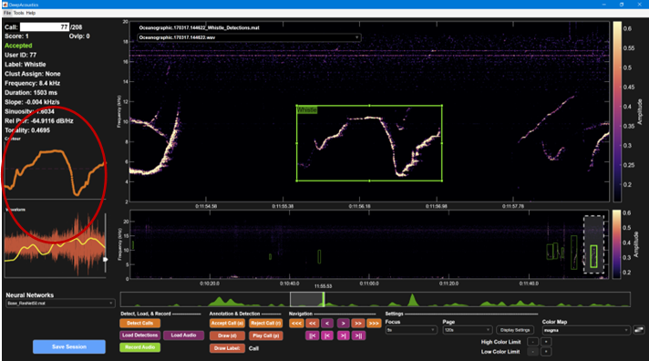
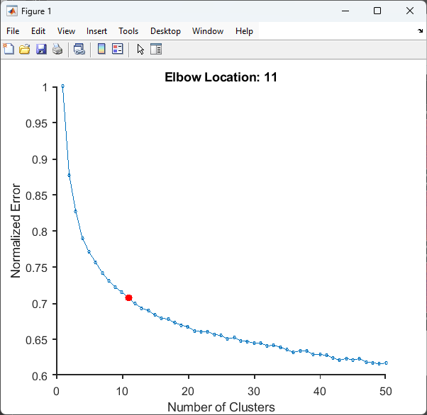
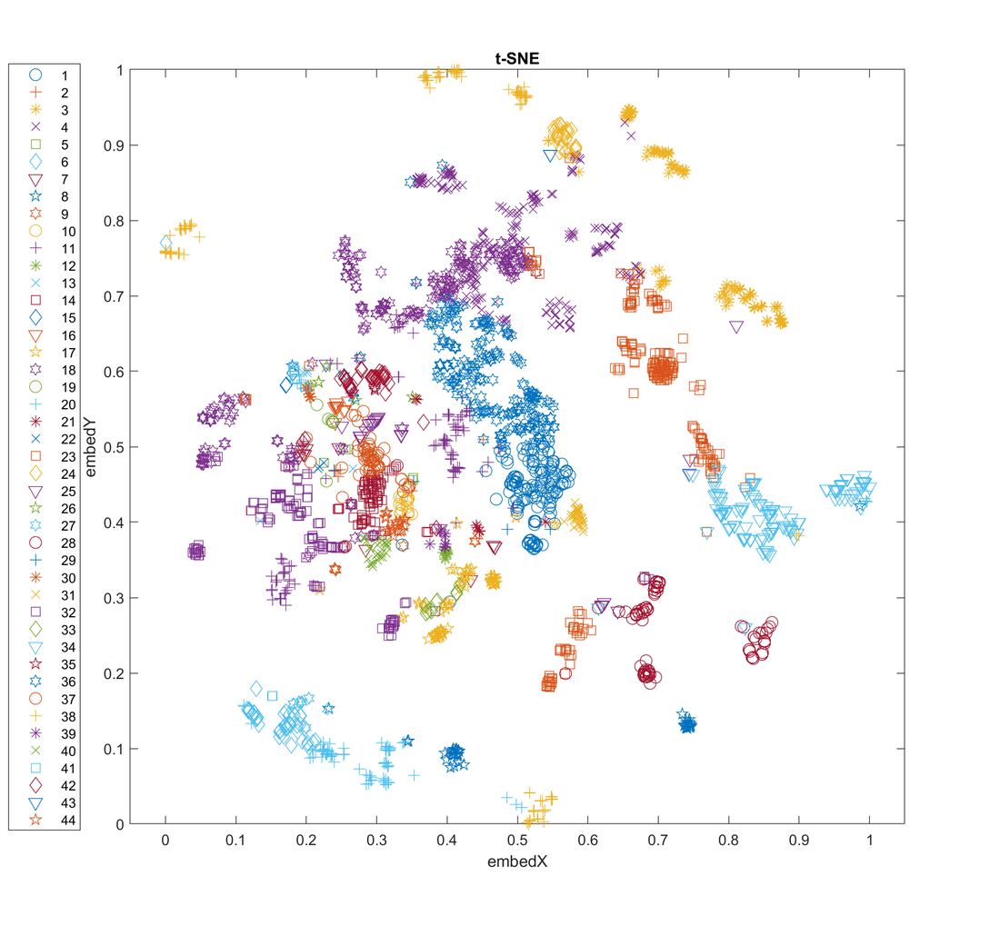
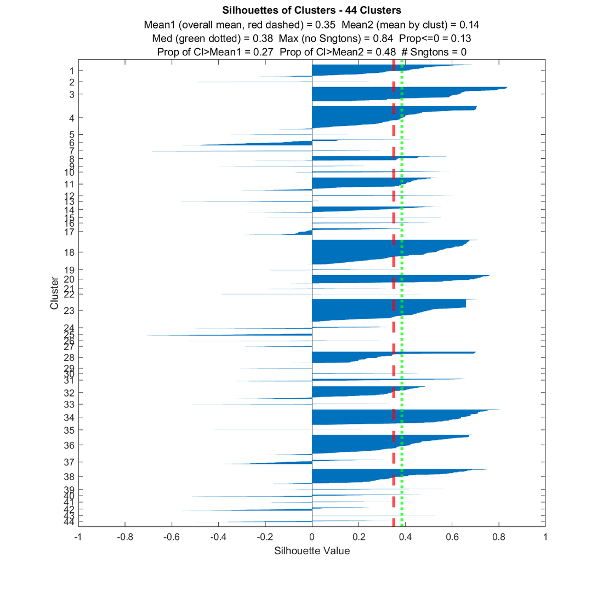
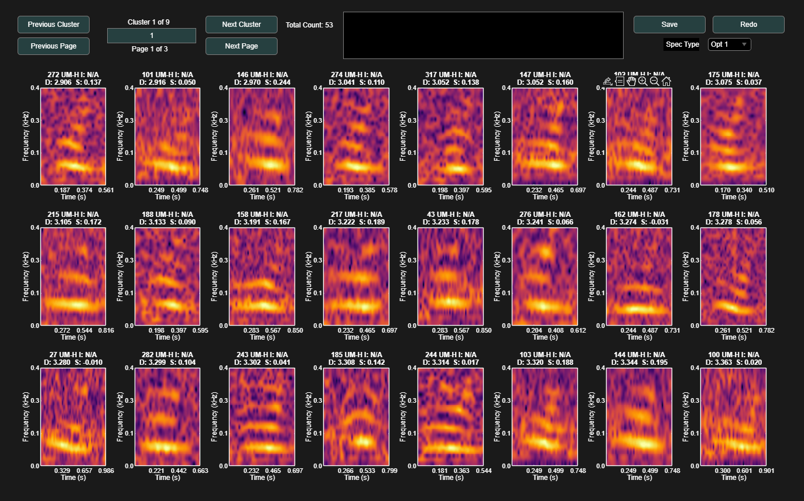
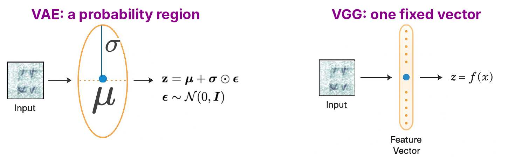

Clustering groups calls by how similar they are, without needing labels. This is useful for exploring a call repertoire: how many distinct call types there are, what they look like, and which calls are hard to place. DeepAcoustics offers two kinds of clustering:

- **Contour clustering:** groups tonal calls, such as whistles, by the shape of their traced frequency contour. This is available now and is described on this page. A step-by-step walkthrough is coming soon.
- **Whole-image clustering with VAE and VGG:** groups calls by the content of their whole spectrogram image, which suits complex calls that cannot be described by a single contour. **This is new and still under development.**

------------------------------------------------------------------------

### Key Terms

**Unsupervised clustering:** grouping data without any labels. The algorithm decides which calls belong together based only on how similar they are.

**k-means clustering:** the clustering method DeepAcoustics uses. You choose (or DeepAcoustics searches for) a number of clusters, *k*. Each cluster has a center, or **centroid**, and each call is assigned to the cluster whose centroid it is closest to. The centroids are adjusted until the assignments stop changing.

**Replicates:** the number of times k-means is run, each time from different starting centroids. The best of the runs is kept. More replicates give more reliable clusters but take longer.

**Contour:** the line traced along the peak frequency of a call over time.

------------------------------------------------------------------------

### Contour Clustering

Contour clustering describes each call by the shape of its contour and then groups calls with similar shapes using k-means.

#### Before you start

- **Review your detections.** Only **accepted** calls are clustered, and calls labeled **Noise** are left out, so review your detections first (see [Annotation Review](annotate.qmd)).
- **Check the contours.** Contour clustering is only as good as the traced contours. Background noise, overlapping calls, and harmonics can pull the trace off the call. The contour of the selected call is shown in the **Contour** panel on the left of the main window, and you can remove or add points that do not fit the call with the contour editing tool before clustering.

{fig-align="center" width="90%"}

#### Running contour clustering

1.  **Open the tool.** Go to **Tools \> Call Classification \> Unsupervised Clustering**.
2.  **Choose the clustering method.** Select **Contour Parameters (recommended)**.
3.  **Choose whether to use a saved model.** Select **No** to build a new clustering model, or **Yes** to apply a model you saved earlier to new data.
4.  **Select the detections file(s).** You can select more than one.
5.  **Set the contour parameters and choose how many clusters to use** (see below).

#### Contour parameters

Each contour is resampled to a set number of evenly spaced points, and several features are measured at those points. Each feature has a **weight**, which sets how much it counts when calls are compared. A weight of 0 leaves that feature out.

- **Number of Contour Pts:** the number of points each contour is resampled to (default 20). More points capture more detail; complex shapes, such as sine waves with several turns, may need more points (we have used 50) to be told apart.
- **Relative Frequency Weight:** the frequency at each point relative to the start of the call, so all contours start at zero. This compares shapes regardless of the call's absolute frequency (default weight 10).
- **Slope Weight:** how quickly the frequency is rising or falling at each point (default weight 5).
- **Concavity Weight:** how the slope is changing at each point, which picks out curves and turns in the contour (default weight 4).
- **Other parameters:** absolute frequency, duration, number of inflection points (where the contour changes from curving up to curving down), and others. These are off (weight 0) by default.

#### Choosing the number of clusters

DeepAcoustics then asks how to choose the number of clusters:

- **Elbow Optimized:** tries every number of clusters up to a maximum and plots the error (how far calls are from their cluster centers) against the number of clusters. It picks the "elbow", where adding more clusters stops reducing the error much.
- **Elbow w/ Min Clust Size:** as above, but if any cluster has fewer calls than the minimum cluster size, it reduces the number of clusters until every cluster is large enough. A minimum of 2 removes clusters made of a single call (**singletons**).
- **User Defined:** you enter the number of clusters.
- **User Defined w/ Min Clust Size:** you enter a starting number of clusters, and DeepAcoustics reduces it until every cluster meets the minimum size.
- **Silhouette Batch:** runs the clustering for a range of cluster numbers and plots silhouette values (see below) for each, so you can compare them.

{fig-align="center" width="50%"}

------------------------------------------------------------------------

### Clustering Results

When clustering finishes, DeepAcoustics shows several figures to help you judge the clusters.

#### t-SNE plot

**t-SNE (t-distributed stochastic neighbor embedding):** a way of drawing high-dimensional data in two dimensions. Calls that are similar are placed close together, and calls that are different are placed further apart. Each point is a call, colored and shaped by its cluster. Tight, well-separated groups suggest distinct call types; overlapping groups suggest call types that are hard to separate. The distances between groups on a t-SNE plot are only a rough guide, so use it to explore rather than to measure.

{fig-align="center" width="70%"}

#### Silhouette plot

**Silhouette value:** a measure, from -1 to 1, of how well each call fits its own cluster compared with the next closest cluster.

- **Close to 1:** the call fits its cluster well and is far from other clusters.
- **Around 0:** the call is on the border between two clusters.
- **Below 0:** the call may fit better in another cluster.

The silhouette plot shows a bar for each call, grouped by cluster. The red dashed line is the overall mean silhouette value and the green dotted line is the median. The title also lists summary values, such as the proportion of calls at or below 0 and the number of singletons. Clusters with mostly long bars are well defined; clusters with short or negative bars contain calls that resist categorization.

{fig-align="center" width="70%"}

#### Other figures

- **Centroid Contours with Max and Min Call Variation:** the average contour shape of each cluster, with the range of its calls (shown when Relative Frequency is used).
- **Closest call to each cluster center:** the spectrogram of the most representative call in each cluster.

#### Reviewing and saving clusters

The **Clustering Dialog** then lets you page through the calls in each cluster, look at their spectrograms, and name the clusters. You can save the clustering model, to apply it to new data later, and the extracted contours with each call's cluster assignment.

{fig-align="center" width="90%"}

#### Other tools in the Call Classification menu

- **View Clusters:** open the Clustering Dialog for detections files you have already clustered, review or rename the clusters, and update the files with the changes.
- **Create t-SNE / UMAP Embedding:** create a t-SNE plot of your calls on its own, based on their contour shape, frequency, and duration (or on VAE embeddings). The UMAP option is not currently active.
- **Syntax Analysis:** explore the order in which call types occur within bouts of calling.

::: callout-note
#### What we are working on: synthetic whistles

We are developing a **hybrid** approach that adds a set of synthetic whistles with known shapes (upsweeps, downsweeps, constant frequency, convex and concave shapes) to the natural whistles before clustering. Because the synthetic whistles have a known answer, they help guide the clusters and check how well the clustering is working.
:::

------------------------------------------------------------------------

### Whole-Image Clustering: VAE and VGG

::: callout-warning
#### Under development

Whole-image clustering with VAE and VGG is new and still under development. This section gives an overview of what is coming. Check back later for updates and step-by-step instructions.
:::

Contour clustering works well for tonal calls with one clear contour, such as whistles. Many calls, such as humpback whale social calls, are pulsed, harmonic, or complex and cannot be described by a single contour. Whole-image clustering uses the entire spectrogram image of each call instead.

#### Key terms

**Dimensionality reduction:** summarizing a high-resolution spectrogram image, made up of thousands of pixel values, into a much smaller set of numbers that captures its key features.

**Latent space:** the compressed space in which a model represents the features of each image.

**Embedding:** the set of numbers (a vector) that represents one call in the latent space. You can think of it as the call's "fingerprint". Calls with similar embeddings are clustered together with k-means.

{fig-align="center" width="90%"}

#### Variational autoencoder (VAE)

A **variational autoencoder** is a generative model with two parts. The **encoder** compresses each spectrogram into the latent space, and the **decoder** tries to rebuild the spectrogram from it. Rather than a single point, the encoder describes each call as a region in the latent space (a mean and a spread), which is why it is called probabilistic. In DeepAcoustics, the VAE is trained on your call spectrograms (resized to 128 × 128 pixels) with no pre-training, and the mean of each call's encoding is used for k-means clustering. It appears as **Auto Encoder + Contour** in the clustering method dialog.

#### Visual Geometry Group network (VGG)

**VGG-16** is a convolutional neural network with 13 convolutional layers and 3 fully connected layers. Here it is used as a **feature extractor**: each spectrogram (224 × 224 pixels) is passed through the network, which produces one fixed embedding for each call that is the same every time. These embeddings are then clustered.

#### What we are testing

- **Fitting calls to one image size:** calls differ in duration and bandwidth, but these networks need every image to be the same size. We are testing different ways to do this, such as resizing the call's spectrogram or placing it on a background of noise.
- **Comparing the methods:** in our tests on humpback whale calls, VGG produced more visually cohesive clusters than the standard VAE model, which needs further optimization and higher resolution.
- **Next steps:** pre-trained networks and more customization.
