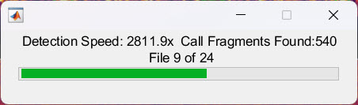
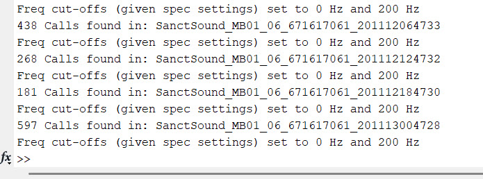
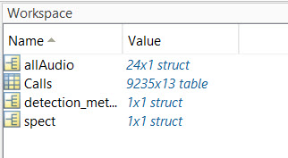
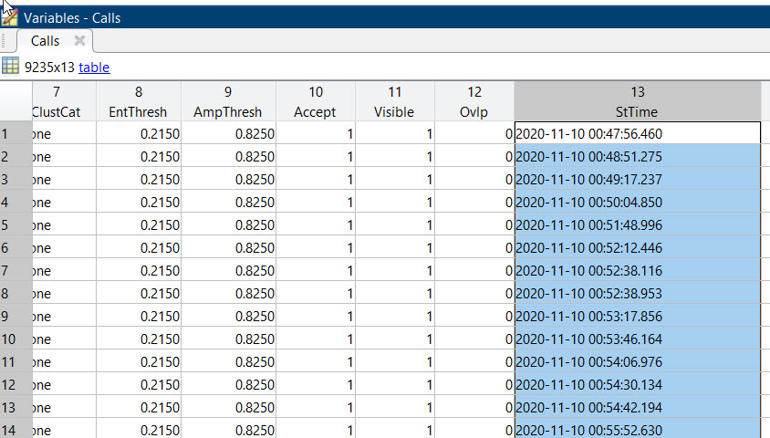
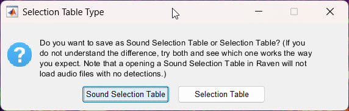

Once you have a network that performs well on your test data (see [Performance Testing](test.qmd)), you can use it to detect calls in new audio. This page covers running the network on your audio, how DeepAcoustics turns the network's raw output into detection boxes, adding the date and time to each detection, and exporting the detections to a Raven selection table.

------------------------------------------------------------------------

### Detecting Calls

#### Before you start

- **Select the audio folder.** Go to **File \> Select Audio Folder** and choose the folder containing the audio you want to run the network on.
- **Select the network folder.** Go to **File \> Select Network Folder** and choose the folder containing your trained network(s). If no network folder is selected, DeepAcoustics shows a **No Network Selected** error and you cannot run detection.

#### Running detection

1.  **Start detection.** In the **Detect, Load, & Record** section, select **Detect Calls**. If you have unsaved changes to a detections file that is already loaded, DeepAcoustics first asks whether you want to save them.

2.  **Select the audio files.** Select all of the audio files you want to analyze. You can select as many files as you like, so you can run the network on any amount of data at once.

3.  **Select the network.** A list shows every network in your network folder. Select the network you want to use.

4.  **Select the output folder.** Choose the folder where the detections file will be saved.

5.  **Enter the settings for running the network.** The **Settings for Running** dialog (titled with the network's name) has three settings, described on the [Performance Testing](test.qmd#settings-for-running-this-network) page:

    - **Total Analysis Length (Seconds; 0 = Full Duration):** use 0 to analyze each audio file in full.
    - **Score Threshold (0-1):** the minimum confidence score a detection needs to be kept. You can use the precision-recall results from performance testing to choose a value; 0 keeps every detection.
    - **Append Date to FileName (1 = yes):** enter 1 to add the date and time of the run to the detections file name.

    The frequency limits are not entered here: they are taken from the network, so the audio is processed with the same settings that were used to create the network's training images. Click **OK** to start.

#### Monitoring progress

While the network runs, a progress bar shows:

- **Detection Speed:** how many times faster than real time the audio is being processed. For example, 2000x means 2000 seconds of audio are processed every second. Tiny YOLO can reach about 2000x on long audio files. Larger architectures such as CSP-DarkNet-53 and ResNet-50 run more slowly, and the bandwidth (frequency range) of the network may also affect the speed. Your computing resources will also impact this speed.

  {width="387"}

- **Call Fragments Found:** the number of raw detections (fragments) found so far in the current file, before they are merged into calls (see [below](#how-call-fragments-are-merged)).

- **File:** which audio file is being processed, out of the total number selected.

The MATLAB Command Window also shows progress for each audio file:

- **Freq cut-offs (given spec settings) set to X Hz and Y Hz:** the frequency range of the spectrograms the network is run on.

- **N Calls found in: \[audio file\]:** the number of calls in that file after merging. Files with no detections are listed as **No Calls found in: \[audio file\]**.

- **Warnings** may appear if the audio has more than one channel (the channels are averaged) or if its sampling rate does not match the network (the audio is resampled or clipped to match the network's frequency range).

  {width="550"}

#### Saving the detections

When all files are processed, DeepAcoustics saves the detections automatically. There is no save dialog. The detections file is saved in the output folder you selected, and its name is built from the name of the first audio file, the number of audio files, and `_Detections.mat`:

`[first audio file]_[N]AudFiles_Detections.mat`

If you entered 1 for **Append Date to FileName**, the date and time of the run is added before `_Detections.mat`. The file is only saved if at least one call was found.

You can then load the detections file with **Load Detections** to review the detections (see [Annotation Review](annotate.qmd)).

------------------------------------------------------------------------

### How Call Fragments Are Merged {#how-call-fragments-are-merged}

The network does not see a whole audio file at once. DeepAcoustics breaks each file into short pieces, runs the network on each piece, and then merges the results into calls. This is why the progress bar counts **call fragments** while the Command Window reports **calls**.

#### Step 1: running the network on overlapping windows

1.  **Windows the length of a training image.** Each audio file is split into windows the same length as the network's training images (the image length stored in the network). Each window starts 80% of an image length after the previous one, so neighboring windows overlap by 20% of an image length. The overlap means a call that falls on the edge of one window also appears in the next.
2.  **One spectrogram per window.** Each window is turned into a spectrogram using the network's spectrogram settings and frequency limits, and processed in the same way as the training images.
3.  **Raw detections.** The network detects calls in each spectrogram, keeping only the strongest of any boxes that overlap heavily within that window. Each detection has a box, a call type, and a confidence score. These raw detections are the **call fragments**.

A call can produce more than one fragment. For example, a call that crosses the boundary between two windows may be detected partly in one window and partly in the next, and a long call may be boxed in pieces.

#### Step 2: merging fragments into calls

After the whole file has been processed, DeepAcoustics merges the fragments:

1.  **Sort by time.** All fragments in the file are sorted by start time.
2.  **Compare in time only.** Fragments are compared using their start and end times only; their frequencies are ignored for this step. Any overlap in time counts, however small.
3.  **Same call type only.** Fragments are only merged if they have the same call type. Overlapping fragments of different call types stay separate.
4.  **Chains are merged together.** If fragment 1 overlaps fragment 2, and fragment 2 overlaps fragment 3, all three are merged into one call, even if fragments 1 and 3 do not overlap each other.
5.  **The merged box covers every fragment.** Each merged call starts at the earliest start time and ends at the latest end time of its fragments, and spans from the lowest to the highest frequency of its fragments.
6.  **The score is the average.** The merged call's confidence score is the mean of its fragments' scores, and it takes the call type of its fragments.
7.  **Apply the score threshold.** Only merged calls with a score above the **Score Threshold** you entered are kept. Because the threshold is applied after merging, it is the average score of the fragments that counts, not the score of any single fragment.
8.  **Keep boxes inside the audio.** Boxes are trimmed so they do not extend past the start or end of the audio file or outside its frequency range.

Every detection is saved as accepted, with no date or time yet.

::: callout-note
#### Calls of the same type that overlap in time are merged

Because fragments are compared in time only, two separate calls of the same type that overlap in time are merged into one detection, even if they are at different frequencies. For example, two overlapping calls of the same type from different animals would appear as a single box covering both. Calls of different types are never merged.
:::

------------------------------------------------------------------------

### Adding the Date and Time

The detections file stores each call's start time in seconds from the start of its audio file. **Add Date/Time** adds the actual date and time of each call, based on the date and time in the audio file names.

1.  **Open the tool.** Go to **Tools \> File Management \> Add Date/Time**.
2.  **Read the overwrite warning.** DeepAcoustics warns that the detections files you choose will be updated and overwritten. If you are unsure, make a backup copy of the detections file first. Click **Yes** to continue.
3.  **Select the detections file(s).** Select the detections file. You can select more than one if they are in the same folder.

For each call, DeepAcoustics reads the start date and time of its audio file from the file name and adds the call's start time within the file. The result is saved in the **StTime** column of the detections, in the format `yyyy-MM-dd HH:mm:ss.SSS` (to the millisecond). Calls that already have a date and time are not changed.

#### Supported file name formats

DeepAcoustics looks for the date and time in the audio file names in these formats, where `.*` means any characters in between:

- **YYYYMMDD.\*HHMMSS:** a four-digit year, for example `20170108_133500`.
- **YYMMDD.\*HHMMSS:** a two-digit year, for example `HYDBBA103OOI_170108-133500`.
- **YYMMDD.\*HHMM:** a two-digit year without seconds (seconds are set to 0).
- **YYYY-MM-DD.HH-MM-SS** or **YYYY_MM_DD.HH_MM_SS:** with dashes or underscores, for example `2017-01-08T13-35-00`.
- **SanctSound file names.**

Four-digit years must start with 20, so dates must be in the year 2000 or later. DeepAcoustics also checks that the date and time are valid (for example, a month from 1 to 12 and an hour from 0 to 23).

#### Checking the date and time

At the moment, DeepAcoustics does not show a confirmation when the date and time have been added. If the file names could not be read, a warning appears in the MATLAB Command Window (**Date/time format not recognizable - please use YYMMDD.\*HHMMSS**), and the calls are left without a date and time.

To check that the date and time were added:

1.  Drag the detections file into the MATLAB Command Window (or double-click it in the MATLAB Current Folder panel) to load it into the workspace.

2.  In the Workspace panel, double-click the **Calls** table.

    {width="267"}

3.  Scroll to the right to the **StTime** column and check that it contains the date and time of each call.

    {width="584"}

------------------------------------------------------------------------

### Exporting to a Raven Selection Table

You can export the detections to a Raven selection table (`.txt`) to view them in Raven or use them in other software.

1.  **Load the detections.** Export to Raven exports the detections file that is currently loaded, so first load it with **Load Detections** (see [Importing Data](import.qmd#loading-the-detections-file)).
2.  **Open the export.** Go to **File \> Import/Export \> Export to Raven**.
3.  **Choose the type of selection table.** DeepAcoustics asks whether to save a **Sound Selection Table** or a **Selection Table**. We recommend **Selection Table**. Note that **Sound Selection Table** is highlighted as the default in the dialog, so make sure to select **Selection Table**.
4.  **Save the table.** Choose where to save the table. The default name is the detections file name followed by `_Raven.txt`.

#### Selection Table vs. Sound Selection Table

- **Selection Table:** the original (legacy) Raven format. Begin and end times are counted continuously across all of the audio files in the detections file, as if they were one long recording. This matches how Raven displays a set of audio files opened together, so open all of the audio files in Raven and then open the table.

- **Sound Selection Table:** begin and end times are counted from the start of each call's own audio file, and the table lists the audio file for each call, so Raven can open the audio from the table. Raven will not load audio files that have no detections when you open a Sound Selection Table.

  {width="394"}

#### What is exported

Only **accepted** calls are exported. Rejected calls are left out, so the selection numbers may skip where calls were rejected. The table has these columns:

- **Selection:** the call's number in the detections file.
- **View and Channel:** set to Spectrogram 1 and channel 1.
- **TimeStamp:** the call's date and time (**StTime**), if it has been added with **Add Date/Time**.
- **Begin Time (s) and End Time (s):** the call's start and end times, counted as described above for the type of table.
- **Low Freq (Hz) and High Freq (Hz):** the call's lowest and highest frequencies.
- **Delta Time (s) and Delta Freq (Hz):** the call's duration and bandwidth.
- **Avg Power Density (dB FS):** not calculated by DeepAcoustics; filled with 1 as a placeholder.
- **Annotation:** the call type.
- **Begin Path and Begin File:** the full path and the file name of the call's audio file.
- **File Offset:** the call's start time within its own audio file, in seconds.
