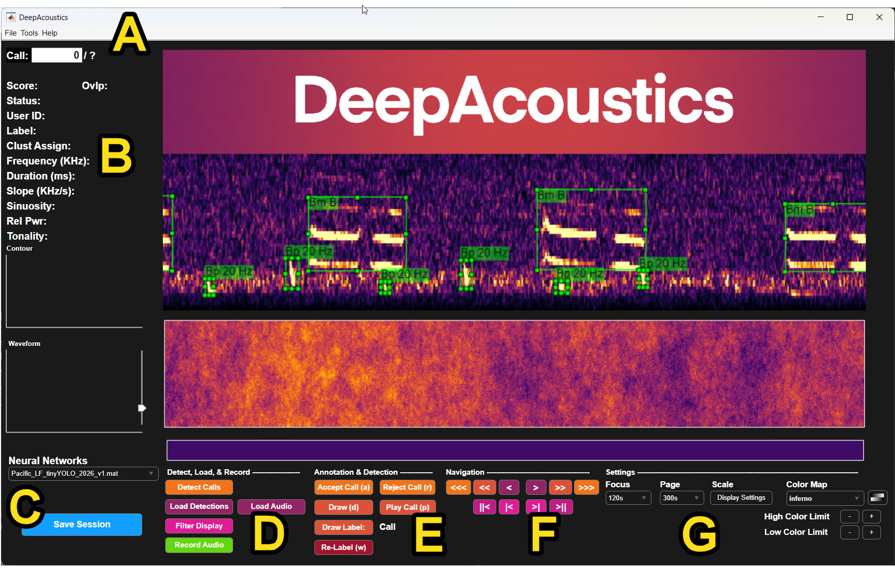

This page walks through the main DeepAcoustics window which is the panel layout you'll see every time you open the app, including specifics of the File menu options. The general descriptions provided in this and the subsequent informative tabs is reinforced through the step-by-step tutorial exercieses.

------------------------------------------------------------------------

### Main window layout

{fig-align="center"}

- **A: Title bar / menu bar.** The File, Tools, and Help menus. File is covered in detail below; Tools and Help are not yet documented here.
- **B: Call detail panel.** Shows the metadata for whichever call is currently in view including the (Confidence) Score, Status, User ID, Label, Clust Assign, Frequency (KHz), Duration (ms), Slope (KHz/s), Sinuosity, Rel Pwr, and Tonality. Given the original intent of DeepSqueak was detection of ultra-high frequency rat vocalizations and Coffey et al. (2019) intended it as a tool for clustering call types, this per call information is accompanies by a Contour and Waveform displays beneath it. Additional descriptions of these features are available in the classification/clustering section.
- **C: Neural Networks selector and Save Session.** The dropdown chooses which trained network (`.mat` file) is available in the folder for detection; the blue Save Session button writes your current session (loaded audio, detections, annotations, and settings) to disk.
- **D: Detect, Load, & Record.** Run the active network on the loaded audio (Detect Calls), load existing detections or audio, filter the display, or record new audio.
- **E: Annotation & Detection.** The accept/reject and manual-annotation controls used while reviewing calls. A user can either Accept Call, Reject Call, Draw, Play Call, Draw Label, and Re-Label, each with its keyboard shortcut shown in parentheses.
- **F: Navigation.** Step through calls and pages of the spectrogram display, from single-call steps up to jumping to the first/last call.
- **G: Settings.** Focus and Page duration, Display Settings, Color Map, and the High/Low Color Limit controls that adjust how the spectrogram is rendered.

------------------------------------------------------------------------

### The File menu

The File menu is where a session usually starts, pointing DeepAcoustics at a trained network and a folder of audio, then loading or saving your work as you go.

1.  **Select Network Folder** points DeepAcoustics at the folder containing your trained network(s). Once selected, the available networks populate the Neural Networks dropdown (panel C above).

2.  **Select Audio Folder** points DeepAcoustics at the folder of audio files you want to work with for the current session.

3.  **Load Detections** loads a previously saved detections file (a `.mat` file, either one DeepAcoustics produced earlier via Detect Calls, or one saved from a prior session). After you select a file, a dialog lists the call types saved in that file and lets you choose which ones to load:

    Note the warning in that dialog: if you save the session afterward without changing the detections file name, it will overwrite the existing file with *only* the call types you selected here. If you want to keep the full original file intact, save under a new name.

4.  **Load Annotations** loads a ground-truth annotation file for review or for use in training/testing see [Preparing Your Data](prep.qmd) for the expected format.

5.  **Change Playback Rate** opens a small dialog for adjusting the speed at which audio is played back during review (default 0.05):

6.  **Change Contour Threshold** opens a dialog with two settings that control how sensitively the contour overlay is drawn on the spectrogram:

    - **Tonality Threshold** (range 0 to 1, default 0.215): how tonal a region of the spectrogram must be before a contour is drawn there.
    - **Amplitude Percentile Threshold** (range 0 to 1, default 0.825): the amplitude percentile a pixel must exceed to be included in the contour.

7.  **Save Session** (Ctrl+S) writes your current session (loaded audio, detections, annotations, and settings) to disk.

8.  **Import/Export** provides options for importing annotations into DeepAcoustics.

- **Export to Raven:** Exports your annotations from DeepAcoustics into a Raven selection table (a tab-delimited `.txt` file) that can be opened directly in Raven.
- **Export to TensorFlow:** A two-step process for converting a neural network developed in DeepAcoustics into a TensorFlow model that can be imported into PAMGuard. More details on this process are provided in the following sections.
- **Export Spectrogram:** Saves the spectrogram image currently shown in the DeepAcoustics display panel as a PNG file.
- **Export Audio:** Exports an audio selection as a separate audio file.
- **Export Excel Log (Call Statistics):** Exports an Excel log (`.xlsx`) of details from your annotations in DeepAcoustics. For each call, the log includes its label, confidence score, and whether it was accepted, along with its begin and end times, duration, frequency measurements (principal, low, high, and peak frequency), slope, sinuosity, mean power, and tonality.
- **Export to Sonic Visualizer:** Exports your annotations as a `.csv` file of start time, end time, low frequency, high frequency, and label. You can then load this file as an annotation layer in Sonic Visualiser, a free, open-source desktop application from the Centre for Digital Music at Queen Mary University of London for viewing and analyzing audio recordings, including spectrograms and annotation layers.
- **Import from Raven:** The main way to bring annotations into DeepAcoustics from Raven selection tables. You are first prompted to select the Raven table and then the associated audio file. You can also import multiple Raven tables and audio files at once.
- **Import from Sonic Visualizer, Ultravox, MUPET, and X-BAT:** Legacy import tools carried over from DeepSqueak.

### The Tools menu

The Tools menu is the most heavily used section of DeepAcoustics. It contains all of the network training, call classification, and review tools.

1.  **Network Training** is where you create training images and then use them to train detection networks:

    - **Create Detection Network Training Images**
    - **Train Detection Network**

2.  **Call Classification** contains the call contour classification components, along with newer VAE and VGG classification tools that are still being developed. It is also where you can view clusters and create t-SNE and UMAP embeddings to visualize how calls group together.

3.  **File Management** contains utilities for preparing and combining detection files:

    - **Merge Detection Files** combines multiple detection files into one.
    - **Add Date/Time** adds date and time information to a detection file.
    - **Add Random Noise** adds random noise to a file.

4.  **Automatic Pruning** provides batch tools for cleaning up detection files:

    - **Batch Reject by Threshold** rejects all calls that fall below a chosen threshold.
    - **Remove Rejected Calls** permanently removes rejected calls from a detection file.
    - **Set Static Box Height (Frequency)** sets every bounding box to the same frequency range.

5.  **Performance Metrics** calculates precision, recall, and other metrics used to evaluate how well a network performs on a test dataset.

6.  **Contour Tracing** opens a separate GUI window where you can manually adjust the contours generated in the tonality window.

7.  **Call Review** provides a way to batch review the call detections a network has created, so you can work through a detection file quickly.

### The Help menu

The Help menu gives quick access to version information, documentation, and keyboard shortcuts.

1.  **About DeepAcoustics** shows the version of DeepAcoustics you are running.

2.  **View Manual** opens this guide in your web browser.

3.  **Keyboard Shortcuts** displays a list of the shortcuts available while reviewing calls:

    | Action              | Shortcut                                 |
    |---------------------|------------------------------------------|
    | Save file           | Ctrl+S                                   |
    | Next call           | E or Right Arrow                         |
    | Previous call       | Q or Left Arrow                          |
    | Accept call         | A                                        |
    | Reject call         | R                                        |
    | Delete call         | Delete or right-click                    |
    | Redraw box          | D                                        |
    | Play call audio     | P                                        |
    | Set call label      | Double-click (see **Add Custom Labels**) |
    | Slide focus forward | Up Arrow                                 |
    | Slide focus back    | Down Arrow                               |
    | Next page           | Space                                    |
