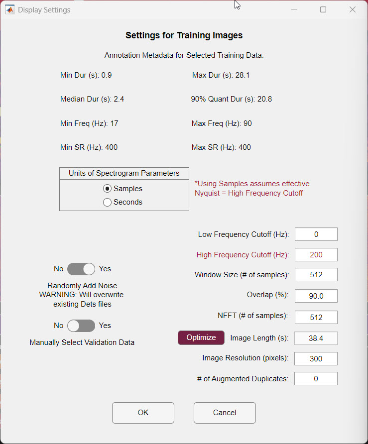

Before DeepAcoustics can train a detection network, it converts your annotated audio into a set of spectrogram images, each paired with the bounding boxes of the calls it contains. This page walks through creating those training images and explains each of the image settings.

The example on this page uses five training annotation (detections) files containing blue whale A and B calls and fin whale 18 Hz and 20 Hz calls, recorded on Ocean Observatories Initiative (OOI) hydrophones off Newport, Oregon. These files are part of a Dryad repository from a recent multiclass baleen whale effort, available here: **Annotated training and evaluation data and DeepAcoustics-derived networks for multi-class baleen whale calls** (doi: <https://doi.org/10.5061/dryad.x0k6djj2d>)

------------------------------------------------------------------------

### Creating the Images

1.  **Open the tool.** Go to **Tools \> Network Training \> Create Detection Network Training Images**.

2.  **Select the detection files.** Choose one or more detections files to build the training images from, then click **Open**. In this example, all five files are selected. Keeping your annotations in separate detections files (for example, by site, deployment, or call type) makes it easy to train on different combinations of files later.

3.  **Choose the call types.** As each file loads, DeepAcoustics asks which call types to include. Each file lists the call types annotated in it, so the options can differ from file to file. This lets you annotate everything in your data once and then train a network for only certain species or call types. In this example, all call types are selected in every file.

4.  **Set the training image settings.** The **Settings for Training Images** dialog opens. The settings are described in detail [below](#training-image-settings). Click **OK** when you are done.

    {width="490"}

5.  **Select the output folder.** Choose the folder where the training images will be saved. If you turned on **Manually Select Validation Data**, DeepAcoustics then asks for the validation detections files and a separate folder for the validation images (see [below](#toggles)).

6.  **Let the images generate.** DeepAcoustics creates the spectrogram images, and you will see them start to appear in your output folder. Augmented duplicates, if any, are saved in an `ImgAug` subfolder.

7.  **Review the summary and save the image table.** When finished, DeepAcoustics shows a summary of the calls and noise included (see [Understanding the summary](#understanding-the-summary)) and asks where to save the image table. By default, it is named after the first detections file, followed by `&More` if you selected more than one file, and `_Images.mat`. This `.mat` file lists every training image and the bounding boxes in it, along with the spectrogram settings used, and it is what you select when training the network.

    

::: callout-warning
#### Choose the image table location carefully

The image table stores the full path to each training image. If you move or rename the image folder after creating the table, DeepAcoustics will not be able to find the images. Decide where the images and table will live before you create them. (A fix for this is in progress.)
:::

------------------------------------------------------------------------

### Training Image Settings {#training-image-settings}

The **Settings for Training Images** dialog controls how your audio is turned into images. These settings matter a great deal for network performance, so it is worth taking time to choose them.

#### Annotation metadata

At the top of the dialog, DeepAcoustics summarizes the annotations you selected, to help you choose the settings below:

- **Min Dur (s) and Max Dur (s):** the shortest and longest annotated call, in seconds.
- **Median Dur (s):** the median call duration.
- **90% Quant Dur (s):** the duration that 90% of your calls are shorter than. This is a useful guide for image length because it ignores the few very longest calls.
- **Min Freq (Hz) and Max Freq (Hz):** the lowest and highest upper frequency limit among your annotated boxes. Use **Max Freq (Hz)** to check that your **High Frequency Cutoff (Hz)** is high enough to include your calls.
- **Min SR (Hz) and Max SR (Hz):** the lowest and highest sampling rate among your audio files. These should be the same. If your files have different sampling rates, DeepAcoustics warns you and uses the lowest one.

#### Spectrogram settings

These settings work the same way as the spectrogram settings described under [Display Settings](import.qmd), but here they control the training images rather than the display. Make sure the window size and NFFT suit the call types you are training on.

- **Units of Spectrogram Parameters:** whether **Window Size** and **NFFT** are entered as a number of **Samples** or as a duration in **Seconds**.
  - When using **Samples**, DeepAcoustics treats the sample counts as if the audio were sampled at twice the **High Frequency Cutoff (Hz)** (the "effective Nyquist" noted in red in the dialog). If you change the High Frequency Cutoff, the sample counts are updated automatically so the window keeps the same duration in seconds.
- **Low Frequency Cutoff (Hz) and High Frequency Cutoff (Hz):** the frequency range included in the training images. The High Frequency Cutoff defaults to half the sampling rate and must not be set above the bandwidth available in your audio. Any part of a call that falls outside this range is excluded from training, and DeepAcoustics warns you if this happens.
- **Window Size:** the length of each chunk of audio analyzed for one column of the spectrogram. Longer windows give finer frequency resolution but blur timing; shorter windows show timing more sharply but blur frequency.
- **Overlap (%):** how much each window overlaps the next. It must be less than 95%.
- **NFFT:** the number of points in the Fourier transform of each window, which sets the spacing between frequency bins. It is usually set equal to the window size.

#### Image settings

- **Image Length (s):** the duration of audio shown in each training image. By default, it is set to twice the 90% quantile duration (rounded), unless **Optimize** is on.
- **Optimize:** when this button is pressed in (highlighted), DeepAcoustics calculates the image length automatically so that each pixel across the image represents exactly one time step of the spectrogram. The image length then updates on its own whenever you change the **NFFT**, **Overlap (%)**, or **Image Resolution (pixels)**, and the Image Length field cannot be edited. Press it again to turn it off and enter an image length yourself.
- **Image Resolution (pixels):** the width and height of each training image, in pixels. Images are always square, and the default is 300 × 300. Larger images can show more detail, but they take longer to train and use more memory, and you will eventually run into the limits of your computer.
- **\# of Augmented Duplicates:** how many extra, slightly altered copies of each training image to create. Each duplicate randomly varies the image contrast and the FFT size (up to two powers of two smaller or larger than your setting), which gives the network more varied examples. This can help when you have a small number of training annotations. The default is 0 (no duplicates).

#### Toggles {#toggles}

- **Randomly Add Noise:** when set to **Yes**, DeepAcoustics adds "Noise" boxes to unannotated parts of your audio before creating the images. It aims for roughly as many noise boxes as calls, with sizes based on the range of your call box sizes and within your frequency limits. This gives the network examples of what is *not* a call. We recommend **Yes**, unless noise has already been annotated in your files (if a file already contains Noise, DeepAcoustics skips it).

- **Manually Select Validation Data:** controls how validation data are chosen. Validation data are held back from training and used to check how well the network is learning (and whether it is overfitting) as training progresses.

  - **No:** all of your selected files are used for training images, and a percentage of them is automatically set aside for validation during training. This is the simplest option and was the only option in earlier versions of DeepAcoustics.
  - **Yes:** after you click **OK**, you choose separate detections files to use only for validation, plus a separate output folder for the validation images, which must be different from the training image folder. DeepAcoustics creates a second image table (ending in `_ValImages.mat`). This gives you more control over exactly which calls and audio files are used for validation, which can ultimately produce a more robust network.

  In this example, **Manually Select Validation Data** is set to **No** because all of the annotations are in one folder, and with multiclass data it is harder to set aside a healthy sample of every call type for both training and validation.

::: callout-warning
#### Randomly adding noise changes your detections files

When **Randomly Add Noise** is set to **Yes**, the new noise boxes are **written into your existing detections files**. Keep a backup copy of your detections files if you want to preserve the originals.
:::

------------------------------------------------------------------------

### Choosing Image Length and Resolution {#choosing-image-length-and-resolution}

#### Why image length matters

DeepAcoustics is an object detection tool, so the training images should not be cropped tightly around each call. The network needs to see the call *in context*, including the background noise around it, so it can learn what is and is not a call. A longer image length captures more representative noise around each bounding box, and an image can contain several annotations. An image length that is too short is a problem because it does not capture enough of that surrounding noise.

As a rule of thumb, an image length of about 2 to 3 times the duration of your longest typical call includes a good amount of noise. If a call is longer than the image length, it is split across images, and DeepAcoustics reports how many calls were split in the summary.

#### How Optimize calculates image length

Each column of pixels in a training image should ideally represent one time step (hop) of the spectrogram. Optimize uses this to calculate the image length:

- **Time step (hop) in seconds** = NFFT in seconds × (1 − Overlap ÷ 100)
- **Optimized image length** = time step × Image Resolution (pixels)

For the example dataset shown in the dialog (a 400 Hz sampling rate with a High Frequency Cutoff of 200 Hz, an NFFT of 512 samples, 90% overlap, and an image resolution of 300 pixels):

- NFFT in seconds = 512 ÷ 400 Hz = 1.28 s
- Time step = 1.28 s × 0.1 = 0.128 s
- Optimized image length = 0.128 s × 300 pixels = **38.4 s**

As another example, with a 32,000 Hz sampling rate, an NFFT of 1024 samples, 90% overlap, and 288 pixels, the time step is 1024 ÷ 32,000 × 0.1 = 0.0032 s, giving an optimized image length of about 0.92 s.

- **If the image is longer than this,** neighboring time steps are squeezed together to fit the available pixels, so some time resolution is lost.
- **If the image is shorter than this,** several pixels are used to show the same time step, which is an inefficient use of the image.
- **Doubling the NFFT** (for example, from 1024 to 2048) doubles the optimized image length, because each time step becomes twice as long. It also increases the frequency detail, which the available pixels may not be able to show in full.

When you click **OK**, DeepAcoustics also checks your settings and warns you if the image resolution is smaller than the number of frequency bins in your chosen bandwidth, or smaller than the number of time steps in your image length. In either case, some detail will be lost when the spectrogram is resized to fit the image.

::: callout-note
#### Balancing image length against calls being split

If your longest calls are much longer than the optimized image length, you have a trade-off: keep the optimized length and accept that some calls are split across images, or use a longer image length and accept lower time resolution. There is no single right answer, and the best way to find out which works better for your calls is to try both and compare the resulting networks.
:::

#### Image resolution and the network input size

The image resolution sets how many pixels each training image has, not how much time or frequency it shows. Every training image covers exactly the same duration and bandwidth.

When you train, the images are resized to the network's input size. This is a change in resolution, not a "zoom" into part of the image: the whole image is kept and simply shown with more or fewer pixels.

- **TinyYOLO** requires an input size that is a multiple of 32, so a 300-pixel image is rounded to 288 pixels.
- **CSP-DarkNet-53** asks you for an input size, because 288 pixels may be too large for your GPU.
- **ResNet-50** uses a fixed input size of 224 × 224.

------------------------------------------------------------------------

### Understanding the Summary {#understanding-the-summary}

When the images have been created, DeepAcoustics displays a summary box like this one, from the example dataset:

```         
Final Call Information:
# Total Calls in Det Files: 4168
# Whole Calls in Images File: 3734
# Split Calls in Images File: 434
# Total Call Pieces in Images File: 4580
# Noise in Images File: 2287
# Total Calls in Det Files (Val): 0
# Whole Calls in Images File (Val): 0
# Split Calls in Images File (Val): 0
# Total Call Pieces in Images File (Val): 0
# Noise in Images File (Val): 0
```

- **\# Total Calls in Det Files:** the number of accepted calls (not including noise) in the detections files you selected. Rejected calls are not used. The example has 4,168 calls.
- **\# Whole Calls in Images File:** calls that fit entirely within a single image (3,734 in the example).
- **\# Split Calls in Images File:** calls that were longer than the image length, or fell across an image boundary, and had to be split across images (434 in the example). Whole calls plus split calls always add up to the total number of calls (3,734 + 434 = 4,168).
- **\# Total Call Pieces in Images File:** the total number of call boxes across all images, counting each piece of a split call separately. In the example, the 434 split calls became 846 pieces, so the images contain 3,734 + 846 = 4,580 call boxes.
- **\# Noise in Images File:** the number of noise boxes included (2,287 in the example). This count currently also includes the noise in augmented duplicates.
- **(Val) counts:** the same counts for the validation images. These are only filled in if you set **Manually Select Validation Data** to **Yes**. In the example, they are all 0 because no separate validation files were selected; instead, a portion of the training images is randomly set aside for validation when the network is trained.

::: callout-tip
#### Checking for split calls

A large number of split calls means many calls are longer than your image length. In the example, about 10% of calls were split, which reflects the long blue whale calls relative to the image length. If many of your calls are being split, consider a longer image length (see [Choosing Image Length and Resolution](#choosing-image-length-and-resolution)).
:::

The number of calls is not the same as the number of images. A single image can contain several calls, and each noise box gets its own image, so the two counts will usually differ. After you save the image table, the MATLAB Command Window reports the total number of images created (for example, "Created 2751 Training Images"). This is the number of images in the image table, **including** augmented duplicates, and should match the number of image files in your output folder and its `ImgAug` subfolder.
