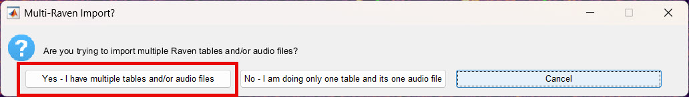
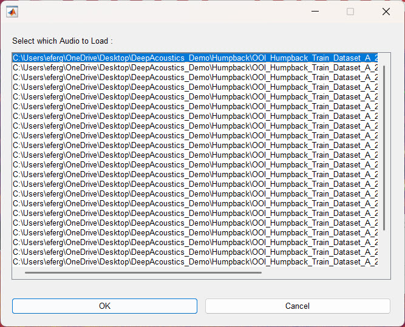
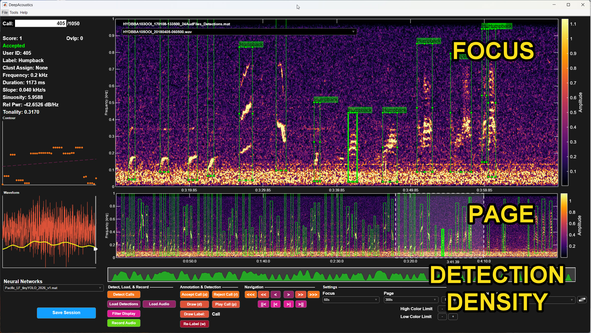
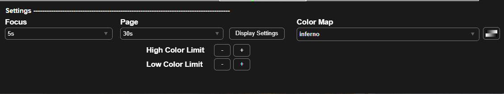

Once your audio and annotation files are ready (see [Preparing Your Data](prep.qmd)), the next step is to bring them into DeepAcoustics. This page covers two parts of that process: importing a Raven selection table so DeepAcoustics saves it as a detections `.mat` file, and adjusting the display settings so you can see and navigate your data.

------------------------------------------------------------------------

### Importing a Raven Selection Table

DeepAcoustics does not work directly from Raven selection tables. Instead, it converts them into its own detections file format (`.mat`), which is what you load for review, training, and testing.

1.  **Open the Raven import.** Go to **File \> Import / Export \> Import from Raven**.

2.  **Answer the Multi-Raven Import prompt.** A dialog asks whether you are importing multiple Raven tables and/or audio files, or only one table and its one audio file:

    - **Yes - I have multiple tables and/or audio files:** the option you will choose most of the time.
    - **No - I am doing only one table and its one audio file:** a legacy option from DeepSqueak, which could only import single audio files. It can still be useful if you are working with one long audio file.

    

3.  **Select the selection table.** Navigate to the Raven selection table (`.txt`) containing your annotations or test data, and select it.

4.  **Select the audio folder.** DeepAcoustics then asks for the folder containing the audio files that go with the selection table. Select that folder and click **OK**. DeepAcoustics always asks for this folder during import, even if you selected an audio folder earlier. Additionally, you will be prompted to select an audio file to load. You will be able to navigate to and load the other files, but this is indicating where you want to start in your review:

5.  **Save the detections file.** Finally, DeepAcoustics asks where to save the new detections file. By default, the file name is built from the name of the first audio file, the total number of audio files, and `_Detections.mat`. For example:

    `HYDBBA103OOI_170108-133500_24AudFiles_Detections.mat`

    If a file with the same name already exists in that location, it will be overwritten.

::: callout-tip
#### Name your `.mat` files clearly

DeepAcoustics saves several kinds of files with the same `.mat` extension, including detections files and training image files. Suffixes such as `_Detections` and `_Images` help, but it is worth adding a clear prefix or suffix of your own so you can always tell what a file contains. For example, adding `Annotations` to the name of a file of manually annotated calls (such as `Train_Annotations.mat`) separates it from a file of detections produced by a network.
:::

------------------------------------------------------------------------

### Visualizing the Data

Once the detections file is saved, you can load it and adjust the display to suit your calls.

#### Loading the detections file

1.  **Load the detections.** Go to **File \> Load Detections** (see [GUI Overview](gui_overview.qmd)) and choose your detections file. If your file has a single call type, it will simply open. If there are multiple call types, a dialog lists the call types in the file and lets you choose which ones to load. See the next section about Annotation Review for how to best use this feature.

2.  **Choose a starting audio file.** DeepAcoustics asks which audio file to load. This only sets where in the dataset you start; all the other audio files remain available. In most cases, select the first audio file in the folder and click **OK**.

{width="538"}

::: callout-important
If you save your session afterward without changing the detections file's name, DeepAcoustics will overwrite the existing file, keeping only the call types you selected when loading it. To keep the complete original file, save your session under a new file name instead.
:::

#### Adjusting the display settings

When you first load a detections file, the spectrogram may still use settings from the last file you loaded, or the default settings. For example, if you last reviewed blue whale calls and are now loading dolphin detections, the display will still be set up for blue whales. You will usually need to adjust the controls in the **Settings** panel before your calls display well.

**Focus and Page durations**

- **Focus:** sets the duration shown in the upper (focus) spectrogram. A value of around 30 seconds is a good starting point for getting an overall sense of a file. You can then shorten or lengthen it to zoom in or out, depending on your calls and what you want to see.
- **Page:** sets the duration shown in the lower (page) spectrogram panel. It works well to set this to the length of your audio files, for example 600 seconds for a 10-minute file or 300 seconds for a 5-minute file. You can then see where all the annotations fall within the file.

Detections are also marked along the very bottom of the window. The green density plot shows where detections are concentrated within the loaded file.

{fig-align="center"}

The controls for the focus and page time scales are adjacent to the color map tools. For both of the focus and page screens, a user can either define a duration to display, or select from a few pre-set settings.

{fig-align="center"}

**Display Settings**

Select **Display Settings** to open the spectrogram settings dialog. When you click **OK**, the spectrograms are redrawn with the new settings and the color limits are recalculated.

- **Frequency Lower Limit (Hz) and Frequency Upper Limit (Hz):** the range of frequencies shown on the spectrogram, in Hz. The lower limit must be less than the upper limit, and the highest frequency that can be displayed is half the sampling rate. For example, the example file has a 2000 Hz sampling rate, so the upper limit is set to 1000 Hz.
- **Spectrogram Units:** the units of the values plotted in the spectrogram, which are also shown on the color bar beside it.
  - **Amplitude:** the magnitude of each time and frequency bin of the spectrogram (the default).
  - **Power Spectral Density:** the power in each bin, normalized by the sampling rate and the window, and shown on a logarithmic (dB) scale. This can make faint calls easier to see against background noise.
- **Units of Spectrogram Parameters:** whether **Window Size** and **NFFT** are entered as a number of **Samples** or as a duration in **Seconds**. The two are equivalent (seconds = samples ÷ sampling rate). Seconds can be convenient when you work with files at different sampling rates, because the same duration gives the same time resolution.
- **Window Size:** the length of each chunk of audio that is analyzed to create one column of the spectrogram. Longer windows give finer frequency resolution but blur rapid changes in time; shorter windows show timing more sharply but blur frequency. Long, low-frequency tonal calls (such as blue and fin whale calls) generally suit longer windows, while short or fast-changing calls (such as clicks and whistles) suit shorter windows.
- **Overlap (%):** how much each window overlaps the next. Higher overlap produces a smoother spectrogram along the time axis but takes longer to compute. It must be less than 95%.
- **NFFT:** the number of points used in the Fourier transform of each window, which sets the spacing between frequency bins (sampling rate ÷ NFFT). It is usually set equal to the window size. Setting it larger than the window size pads the window with zeros, which smooths the spectrogram's appearance without adding true frequency resolution.
- **Auto Window Size:** calculates a window size (and sets NFFT to the same value) so that the spectrogram's pixels are roughly square, based on the current Focus duration, the frequency limits, and the overlap. It is a quick starting point when you aren't sure what to use. Audio must be loaded first, because the calculation needs the sampling rate.

**Color Map and color limits**

The spectrogram is drawn by mapping each value (amplitude or power) to a color in the color map, using MATLAB's color limits:

- **Low Color Limit:** any value at or below this limit is drawn in the lowest (darkest) color of the color map.
- **High Color Limit:** any value at or above this limit is drawn in the highest (brightest) color.
- **In between:** values that fall between the two limits are spread evenly across the colors in between.

When the display is updated, DeepAcoustics sets the starting limits automatically from the spectrogram itself, using the 10th and 90th percentiles of its values. Each click of **+** or **-** then moves that limit by 10% of the current range:

- **Raising the Low Color Limit (+)** pushes more of the quieter background into the darkest color, so the background looks darker and calls stand out more.
- **Lowering the High Color Limit (-)** makes more values reach the brightest color, so faint calls appear brighter. If you lower it too far, strong calls saturate and lose detail.
- **Moving both limits closer together** increases the contrast; moving them apart reduces it.

When Spectrogram Units is set to Amplitude, the Low Color Limit cannot go below zero.

- **Color Map:** the set of colors used to draw the spectrogram (for example, inferno). Choose a different color map, or use the button beside it to invert the current one, to find what works best for viewing your data.



#### Navigating through the data

DeepAcoustics offers several ways to move through your dataset, depending on what you are trying to do:

- **Audio file selector:** at the top of the upper (focus) spectrogram, you can select a different audio file and go straight to it.
- **Navigation panel:** at the bottom of the window, buttons move you to the next or previous call, or forward and back through the spectrogram by a small step or a full page.
- **File buttons (pink):** these move to the next or previous audio file, or to the next or previous audio file that contains a call.
- **Go to a specific call:** in the upper left corner, type an annotation number to jump directly to that call. This is useful for returning to where you left off when reviewing or annotating.


