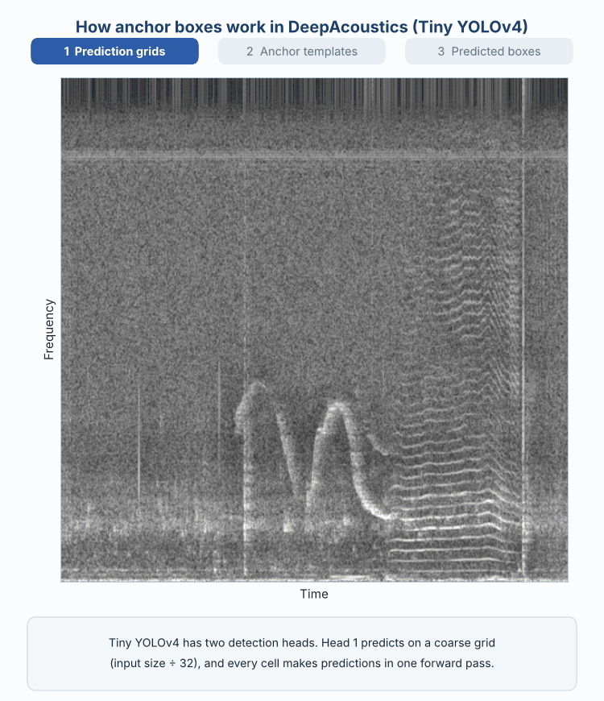

This page lays out the technical building blocks referenced throughout the rest of the guide: the network architectures DeepAcoustics offers, the hyperparameters you can tune when training one, and the metrics used to evaluate how well a trained network performs. The hands-on, step-by-step process of actually creating training images, training a network, and running performance tests in DeepAcoustics is covered separately under **Network Training & Testing**; this page is the conceptual reference those steps point back to.

------------------------------------------------------------------------

### Available architectures

DeepAcoustics offers three pre-trained YOLOv4 backbone architectures. TinyYOLO and CSP-DarkNet-53 are pre-trained on COCO, a segmentation-based database of over 330,000 object images; ResNet-50 is pre-trained on ImageNet, a bounding-box-based database of roughly 1.5 million images.

{fig-align="center"}

| Architecture   | Layers | Parameters   | Detection heads | Pretrained on |
|----------------|--------|--------------|-----------------|---------------|
| TinyYOLO       | 74     | 6.1 million  | 2               | COCO          |
| CSP-DarkNet-53 | 363    | 64.4 million | 3               | COCO          |
| ResNet-50      | 177    | 25.6 million | 2               | ImageNet      |

TinyYOLO is the lightest and fastest to train, making it the natural starting point for optimizing other settings before moving to the larger architectures. CSP-DarkNet-53 is the largest and most complex of the three, with roughly five times TinyYOLO's parameter count and an additional detection head. ResNet-50 sits in between, and additionally requires a fixed 224×224 input resolution (TinyYOLO and CSP-DarkNet-53 instead require an input resolution that is a multiple of 32 pixels).

::: callout-note
#### Guide media placeholder

Short clip or annotated image walking through the trade-offs between the three architectures. To be added once available.
:::

------------------------------------------------------------------------

### Key hyperparameters

Training behavior is governed by a handful of settings a user can tune:

- **Learning rate:** controls how large a step the network takes when updating its weights after each training batch. Values of 0.0001, 0.0005, 0.001, and 0.002 have all been tested; too high a rate can cause unstable training, too low can make training impractically slow.
- **Batch / mini-batch size:** the number of training images processed together before each weight update. Values from 16 up to 512 have been tested; larger batches use more GPU memory but can produce more stable gradient estimates.
- **Epochs:** the number of complete passes through the training dataset. Training is typically monitored via a loss curve (below) to judge when additional epochs stop helping.
- **Optimizer:** the algorithm used to update network weights (e.g., sgdm, RMSProp, adam in MATLAB's implementation); different optimizers can affect convergence speed and stability.
- **Validation split:** the percentage of training data automatically held back each epoch to monitor performance on unseen data during training, rather than supplying a separate validation folder. The reference network used an 18% automatic split.

{fig-align="center"}

How to read a training/validation loss curve: both curves falling together (underfitting; more training may help), both low and stable (good fit), or validation loss rising while training loss keeps falling (overfitting; stop near the point where validation loss is lowest).

#### Anchor boxes

YOLO-family networks don't predict each bounding box from scratch. Instead, they start from a small set of template shapes called anchor boxes and learn how to shift and resize the best-matching template so it fits each call. DeepAcoustics estimates the anchor dimensions from the bounding boxes in your training annotations, using an IoU-distance-based clustering of box widths and heights (MATLAB's `estimateAnchorBoxes`). Because this happens after the training images are resized to the network's input size, the anchors reflect the actual shapes of your calls at the resolution the network sees them, rather than generic defaults.

- **What an anchor is:** a fixed width and height. Anchors describe shape only; where a call sits in the image is handled by the prediction grid, not by the anchors.
- **How anchors are divided:** DeepAcoustics sorts the anchors by area and splits them across the network's detection heads. TinyYOLO and ResNet-50 each have two heads, so the larger half of the anchors goes to the coarse head and the smaller half to the fine head. CSP-DarkNet-53 has three heads and splits the anchors into thirds.
- **Valid anchor counts:** TinyYOLO and ResNet-50 need an even number of anchors, and CSP-DarkNet-53 needs a multiple of three. If you enter a count that doesn't fit, DeepAcoustics rounds it up to the next valid number (for example, 11 becomes 12 on TinyYOLO). The defaults are 8 anchors for TinyYOLO and ResNet-50 and 9 for CSP-DarkNet-53.

{fig-align="center"}

The animation above follows a default 8-anchor TinyYOLO network through these steps:

1.  **Divide the image into prediction grids.** Each detection head views the spectrogram image as a grid of cells. On TinyYOLO, Head 1 uses a coarse grid (input size ÷ 32) and Head 2 uses a grid twice as fine (input size ÷ 16). Every cell makes predictions at the same time, in a single pass through the network.
2.  **Estimate the anchor templates.** Anchor widths and heights are clustered from the annotated boxes in the training data and then sorted from largest to smallest area.
3.  **Assign anchors to detection heads.** The four largest anchors go to the coarse head, which suits large calls, and the four smallest go to the fine head, which suits small calls.
4.  **Repeat the anchors at every grid cell.** Each head places its full set of anchors at every cell of its grid, producing thousands of candidate boxes that are all evaluated at once. The anchors do not slide or scan across the image.
5.  **Match each call to its best anchor.** During training, the anchor whose shape best matches an annotated call (the highest IoU) becomes responsible for that call, at the grid cell that contains the call's center.
6.  **Adjust the anchor to fit the call.** The network predicts a position offset and a width and height scale for that anchor, along with a confidence score and class label. The final box can therefore differ substantially from the anchor's original size.
7.  **Filter the raw predictions.** Detection produces many boxes, including low-confidence boxes and overlapping duplicates of the same call. Boxes below the confidence threshold are removed first, and non-maximum suppression then keeps only the highest-scoring box where several boxes overlap the same call.
8.  **Report the final detections.** What remains is one fitted bounding box per call, each with its class label and confidence score.

##### Choosing the number of anchor boxes

- **Use the mean IoU curve:** When you choose **Customize** during training and don't already know how many anchors you want, DeepAcoustics plots mean IoU against the number of anchors (1 to 15). Choose the smallest number of anchors that still gives an acceptably high mean IoU, which is usually near the bend (or "elbow") of the curve, where adding more anchors stops improving the fit much.
- **Match the count to call variability:** The more your calls vary in duration, bandwidth, and aspect ratio, the more anchors you are likely to need to box them accurately. This matters most for multiclass networks that combine long and short call types. In testing, moving to 8 anchors improved a multiclass network, and higher anchor counts increased recall for sei whale calls.
- **Watch the costs:** More anchors increase computation and memory use and can lead to overfitting. Higher anchor counts (such as 10) have caused training runs to crash on some machines but not others, possibly because of memory limits, so try a machine with more RAM before ruling a configuration out.
- **Comparing architectures:** Because the architectures have different numbers of detection heads, keep the *total* number of anchors as close as possible when comparing them, rather than the number per head. For example, 6 anchors on TinyYOLO compares to 6 on CSP-DarkNet-53; 8 or 10 compares to 9; and 12 compares to 12.
- **Resolution changes the anchors:** Anchors are estimated in the pixel dimensions of the resized training images, so training at a different image resolution produces different anchors even when the anchor count stays the same. Keep this in mind when comparing networks trained at different input sizes.

#### Variability across training runs

Because random factors (weight initialization, data shuffling, augmentation draws) influence each training run, the same TinyYOLO configuration was trained three independent times in developing the reference network, and each resulting network evaluated separately, to characterize how much performance varies for reasons unrelated to the chosen hyperparameters. This context is useful when comparing two configurations that differ only slightly in a performance metric. A difference smaller than the run-to-run variability isn't necessarily meaningful.

------------------------------------------------------------------------

### Performance metrics

#### Intersection over Union (IoU)

IoU measures how much a predicted bounding box overlaps a ground-truth (manually annotated) box. It is calculated as the area of their overlap divided by the area of their union. A higher IoU threshold demands tighter overlap and is therefore a stricter detection criterion.

{fig-align="center"}

IoU = (area of overlap) / (area of union). DeepAcoustics' default true-positive threshold is a fairly permissive IoU ≥ 0.1; mAP then summarizes performance across a range of stricter IoU cutoffs (0.1 to 0.9).

#### Precision, recall, and F1-score

DeepAcoustics' built-in performance evaluation compares network detections against a ground-truth annotation file. Predicted boxes are produced at a 0.5 confidence threshold by default (MATLAB's YOLOv4 default), and a detection counts as a true positive if its IoU with a ground-truth box is at least 0.1.

- **Precision:** the proportion of the network's detections that were correct (true positives ÷ all detections).
- **Recall:** the proportion of actual annotated calls the network successfully detected (true positives ÷ all ground-truth calls).
- **F1-score:** the harmonic mean of precision and recall at the 0.5 confidence threshold, giving equal weight to both and penalizing large gaps between them more than a simple average would.

#### Average precision (AP) and mean average precision (mAP)

A single confidence threshold only tells part of the story, so DeepAcoustics also computes average precision (AP) across the full range of confidence thresholds from 0.5 to 1, at the fixed 0.1 IoU threshold, summarizing the precision/recall trade-off as the confidence cutoff is varied. Mean average precision (mAP) goes a step further, repeating that AP calculation at nine IoU thresholds from 0.1 to 0.9 (in 10% increments) and averaging the results, which captures both how completely calls are detected and how tightly the predicted boxes fit them.

{fig-align="center"}

Matches the style of DeepAcoustics' own performance-evaluation output: each point is one confidence (score) threshold, colored by that threshold's value, with average precision shown in the title. (Example data shown, not a real evaluation run.) AP is the area under this curve at one IoU threshold; mAP averages AP across several IoU thresholds.

Because the "Noise" class exists only as a training-time workaround for a MATLAB datastore limitation (true negatives can't otherwise be included in training), performance metrics are not meaningful for, and are not reported on, that class.
