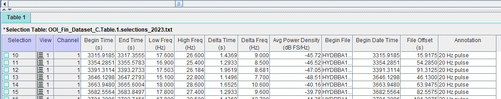
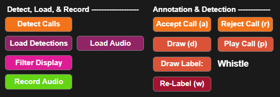
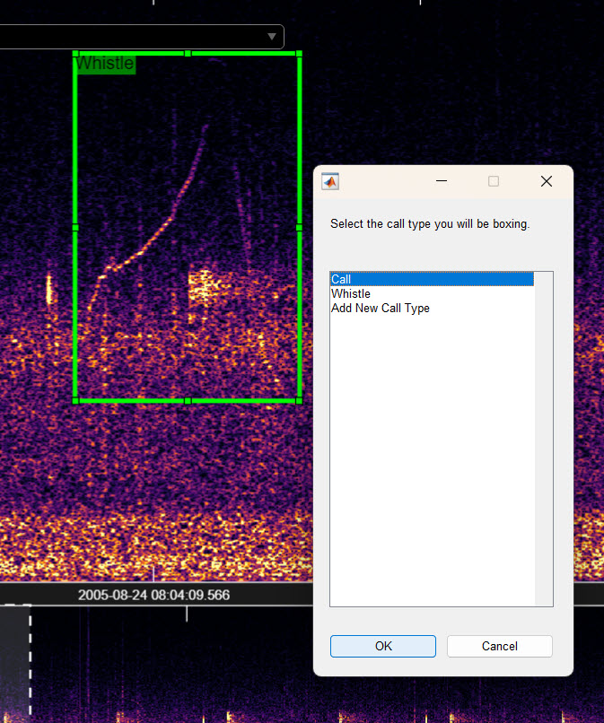

### Bounding Box Annotation for Object Detection

DeepAcoustics trains its detection networks on bounding box annotations. A bounding box annotation is more than a date and timestamp marking when a call occurred. It is a box drawn around the call itself on the spectrogram, and it records four values for each call:

- **Begin time:** when the call starts.
- **End time:** when the call ends.
- **Low frequency:** the lower frequency limit of the call.
- **High frequency:** the upper frequency limit of the call.

Each box is also given a label (for example, a call type or species) so the network can learn to tell different call types apart.

::: callout-important
#### Box every call in the annotated audio

DeepAcoustics does not train on clipped snippets of individual calls. Instead, the full audio files are fed through the system, and the bounding boxes tell the network where the calls are within them. This means **any call that is missed or left unboxed is treated as noise**. During training, the network learns that the unboxed call is *not* a call of interest, which works against both detection and classification. Before training, make sure every call of interest in the annotated audio has been boxed and labeled.
:::

### Selecting the Correct Bandwidth

DeepAcoustics works best when your audio files are prepared to suit the signals you want to detect and classify. Some binary classification methods train on spectrograms, or on short audio clips converted to spectrograms, that are each framed around individual calls of varying bandwidth. DeepAcoustics works differently: it generates its images from the full duration of the audio files you provide. It does not currently decimate (downsample) the data or handle files of different bandwidths.

For this reason, two things are essential:

- **Use the same sampling rate throughout.** The audio used to train, test, and deploy a network must all have the same sampling rate, and therefore the same bandwidth (half the sampling rate).

- **Choose a sampling rate suited to your calls.** The sampling rate should capture the full frequency range of your calls without adding a lot of unneeded bandwidth. For example, a sampling rate of 48 or 96 kHz works best for delphinid calls, while a sampling rate of 400 Hz is better suited to low-frequency blue and fin whale calls.

If you are in need of a decimator for your audio dataset, visit our [Bioacoustic Resources](https://www.oceanscienceanalytics.com/bioacoustic-resources) page for a free easy to use tool, EZ-AudioMate!

### Annotating in Raven

DeepAcoustics can accept annotations from several sources, but the most common, and the format this guide focuses on, is the Raven selection table. Raven is a family of sound analysis software from the K. Lisa Yang Center for Conservation Bioacoustics at the Cornell Lab of Ornithology and is widely used for annotating marine and terrestrial sound recordings. In Raven, each annotated call is a "selection," and a selection table is a tab-delimited text file listing every selection along with its time, frequency, and label information.

The tutorials in this guide highlight **Raven Annotate**, the newer component of Raven Workbench designed specifically for annotating calls within a dataset.

#### Saving a Raven Pro selection table from Raven Annotate

When you finish annotating in Raven Annotate, export your annotations by going to **File \> Export \> Raven Pro Selection Table**. If you are working in Raven, this is the format your annotations should be saved in for import into DeepAcoustics.

**Note:** DeepAcoustics can work with .wav audio files, or the compressed .flac version of audio files.

------------------------------------------------------------------------

### Raven Selection Table

DeepAcoustics reads Raven selection tables saved as tab-delimited `.txt` files (comma-separated `.csv` files are also accepted). Column names must match Raven's standard names exactly, including the units in parentheses. Each call label must be in a column named **Annotation**.

{fig-align="center"}

The table below describes each column in a typical Raven Pro selection table and how DeepAcoustics uses it during import.

| Column | Use in DeepAcoustics | Description |
|------------------------|------------------------|------------------------|
| Selection | Not used | Raven's ID number for each selection. Can be left in the table. |
| View | Not used | The Raven view the selection was made in (for example, "Spectrogram 1"). Can be left in the table. |
| Channel | Not used | The audio channel the selection was made on. DeepAcoustics always reads channel 1 of multichannel audio. |
| Begin Time (s) | Required unless File Offset (s) is present | Start time of the call, in seconds. Used when there is no File Offset (s) column. |
| End Time (s) | Required\* | End time of the call, in seconds. |
| Low Freq (Hz) | Required | Lower frequency limit of the bounding box, in Hz. |
| High Freq (Hz) | Required | Upper frequency limit of the bounding box, in Hz. |
| Delta Time (s) | Required\* | Duration of the call, in seconds. |
| Peak Freq (Hz) | Not used | Frequency with the most energy within the selection. Can be left in the table. |
| Begin File | Strongly recommended | Name of the audio file the call starts in. Lets DeepAcoustics match each call to the correct audio file, so one table can cover many files. |
| File Offset (s) | Required with Begin File | Start time of the call, in seconds, measured from the beginning of the file named in Begin File. When present, DeepAcoustics uses this instead of Begin Time (s). |
| Begin Date Time | Not used | Date and time the selection begins. Can be left in the table. |
| Annotation | Required | The call label (for example, call type or species). Used as the class name for training and detection. Calls with a blank annotation are imported as "Missing Annotation." |
| Quality/Call Descriptor | Not used, but helpful for potential use later in classification/clustering | Optional notes column (for example, flagging a low-quality call). Can be left in the table. |

\*At least one of **End Time (s)** or **Delta Time (s)** must be present, so DeepAcoustics can calculate where each call ends.

::: callout-tip
#### Why Begin File and File Offset (s) matter

If your selection table spans multiple audio files (for example, a day of 5-minute recordings), include the **Begin File** and **File Offset (s)** columns. Without them, DeepAcoustics tries to match each selection table to an audio file by filename, which only works when there is exactly one audio file per table and can cause unexpected behavior later on.

***NOTE:*** Once you have a set of audio files annotated, eliminating specific files from a folder can be problematic on the Raven and DeepAcoustics end. It is best to annotate once your dataset (or subset) is selected to avoid additional data management steps.
:::



------------------------------------------------------------------------

### DeepAcoustics Annotation File

If you prefer, you can create annotations directly in DeepAcoustics instead of using Raven.

1.  **Select your audio folder.** Go to **File \> Select Audio Folder** and choose the folder containing the audio you want to annotate.

2.  **Load the audio.** In the **Detect, Load, & Record** section at the bottom of the window, select **Load Audio**:

{fig-align="center"}

3.  **Draw a bounding box.** Under **Annotation & Detection**, select **Draw (d)**, or press **d** on your keyboard, then draw a box around the call.

4.  **Choose a label.** To change the annotation label assigned to the box, select **Draw Label**. A list of previously created labels appears, along with an option to create a new label. Select the label you want and press **Enter** to create the box:

{fig-align="center" width="438"}

5.  **Save your annotations.** When you finish, select **Save Session**. Your annotations are saved in a DeepAcoustics detections file (`.mat`), which can be used for training and testing just like an imported Raven selection table.

