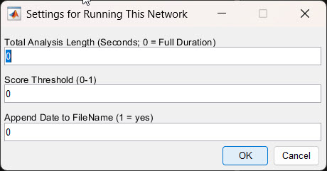
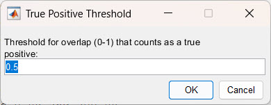
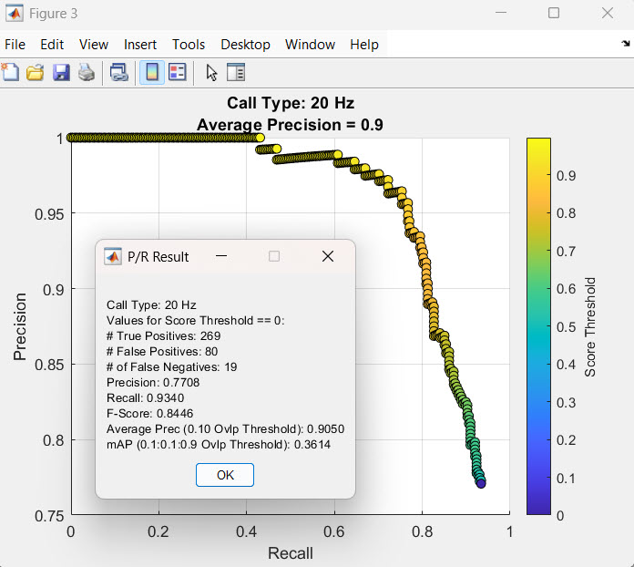
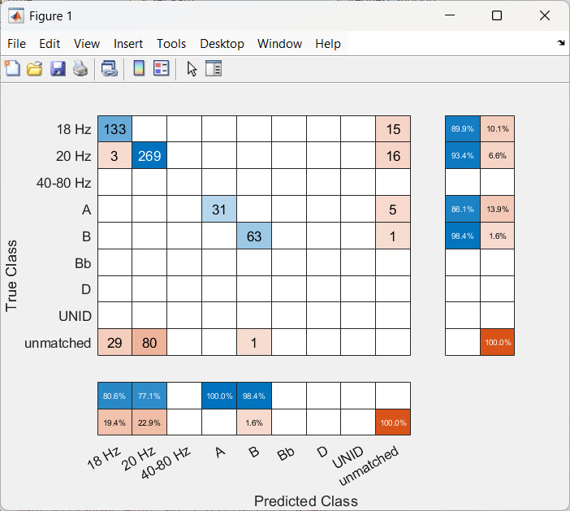

Once you have trained a network (see [Network Training](train.qmd)), the next step is to measure how well it performs. DeepAcoustics does this by running the network on a **test dataset** that you have already annotated, then comparing the network's detections against your annotations. The metrics used here (IoU, precision, recall, F1-score, average precision, and mAP) are defined in [Performance metrics](network_fundamentals.qmd#performance-metrics).

------------------------------------------------------------------------

### Before You Start

- **Prepare a ground-truth test file.** Annotate a test dataset ahead of time, in Raven or in DeepAcoustics, and convert it into a detections `.mat` file. If you annotated in Raven, import the selection table as described in [Importing Data](import.qmd). The test data should not be part of the data used to train the network, so the results show how the network performs on calls it has never seen.
- **Name your files clearly.** Ground-truth files, network detections, and networks are all `.mat` files, and detections files all end in `_Detections.mat`. Give your ground-truth file a name that makes it obvious it contains your verified annotations (for example, `HYDDBA105OOI_20170203_Test_Detections.mat`).
- **Select the network folder.** Go to **File \> Select Network Folder** and choose the folder where you saved the network you want to evaluate.

------------------------------------------------------------------------

### Running Performance Metrics

1.  **Open the tool.** Go to **Tools \> Performance Metrics**.

2.  **Select the ground-truth file.** Choose your ground-truth detections file, the one containing your verified annotations. You can select more than one file if your test data are split across several.

3.  **Choose the call types.** Select the call types to load from the ground-truth file. You can choose a single call type to evaluate on its own, or click **Select all** to evaluate all of them. In this example, all call types are selected.

4.  **Select the network.** Choose the network `.mat` file you want to evaluate. This can be any network you have trained, which is why a clear network name matters.

5.  **Enter the settings for running the network.** The **Settings for Running This Network** dialog has three settings, all of which can usually be left at 0 (see [below](#settings-for-running-this-network)). Click **OK**.

6.  **Let the network run.** DeepAcoustics runs the network on every audio file in the ground-truth file. A **Detecting Calls** progress bar appears, along with a progress window for each audio file as it is processed.

7.  **Set the true positive threshold.** The **True Positive Threshold** dialog asks for the IoU threshold that a detection must reach to count as correct (see [below](#true-positive-threshold)). Click **OK**.

8.  **Review the results.** For each call type, DeepAcoustics displays a precision-recall curve and a **P/R Result** summary, plus a confusion matrix for all call types (see [Understanding the results](#understanding-the-results)).

9.  **Save the performance metrics file.** DeepAcoustics asks where to save the performance metrics (the default name is `PerformanceMetrics.mat`). We recommend saving it in a dedicated folder and renaming it to include both the test file and the network, for example `HYDDBA105OOI_20170203_Test_TinyYOLO_v1_PerformanceMetrics.mat`.

10. **Save the network's detections.** DeepAcoustics then asks where to save the detections the network made on the test data. This is a regular detections file that you can load with **Load Detections** to visually inspect how well the network did, call by call. The default name is built from the name of the last audio file processed and the number of audio files (for example, `HYDDBA105OOI_20170203-060000_49AudFiles_Detections.mat`), so consider renaming it to include the network name.



------------------------------------------------------------------------

### Settings for Running This Network {#settings-for-running-this-network}

This dialog is partly a legacy feature. The frequency limits are taken automatically from the network, so only three settings remain, and all three can normally stay at their defaults of 0:

- **Total Analysis Length (Seconds; 0 = Full Duration):** how much of the test audio to analyze, in seconds. Use 0 to analyze all of it. A shorter length, such as 60 seconds, can be useful for a quick trial run on a long test file.

- **Score Threshold (0-1):** the minimum confidence score a detection needs to be kept. The default of 0 keeps every detection, regardless of its confidence score, so the full precision-recall curve can be calculated. Set it higher (for example, 0.5) only if you want to keep just the more confident detections.

- **Append Date to FileName (1 = yes):** enter 1 to add the date and time of the run to the name of the saved detections file. The default is 0 (no date).

  {width="348"}

### True Positive Threshold {#true-positive-threshold}

The **Threshold for overlap (0-1) that counts as a true positive** is the IoU threshold: how much a detection's bounding box must overlap the matching ground-truth box to count as a true positive (see [Intersection over Union (IoU)](network_fundamentals.qmd#intersection-over-union-iou)). The default is 0.5, a common value in image object detection. The right threshold is up to you and depends on what you need the network's detections for. For example:

- **0.1, detecting the call at all:** a detection counts as correct if its box overlaps the call even a little. Use this when you mainly want to know whether the network finds calls, not how well it boxes them.
- **0.5, detecting the call moderately well:** a detection counts as correct only if its box covers a good part of the call.
- **0.9, boxing almost all of the call:** a detection counts as correct only if its box closely matches the annotated box. Use this when tight boxes matter, for example if you plan to take measurements from the detections.

The example results below use 0.1.

{width="247"}

This threshold is used for the true positives, false positives, false negatives, precision, recall, F1-score, average precision, and confusion matrix. The mAP is always calculated across IoU thresholds from 0.1 to 0.9, regardless of this setting.

------------------------------------------------------------------------

### Understanding the Results {#understanding-the-results}

#### Precision-recall curve and P/R Result

DeepAcoustics produces a precision-recall curve and a **P/R Result** summary for **every call type the network was trained on** (except Noise), even if that call type does not occur in the test file. Call types that are not in the test file will have empty curves and missing values.

**Precision-recall curve:** each point is one confidence (score) threshold. Moving from left to right, the threshold is lowered, so more detections are included: recall rises and precision usually falls. The color of each point shows its score threshold (yellow = high, dark blue = low). The title shows the call type and its average precision (rounded to one decimal place). See [Average precision (AP) and mean average precision (mAP)](network_fundamentals.qmd#average-precision-ap-and-mean-average-precision-map) for how to interpret the curve.

**P/R Result:** these values are calculated at a score threshold of 0, meaning every detection the network made is included:

- **\# True Positives:** detections that match a ground-truth call of the same call type, with an IoU at or above the true positive threshold.

- **\# False Positives:** detections of this call type that do not match a ground-truth call of the same type. This includes detections on noise and detections that matched a call but gave it the wrong call type.

- **\# of False Negatives:** ground-truth calls of this call type that the network missed (or detected with the wrong call type).

- **Precision:** true positives ÷ all detections of this call type.

- **Recall:** true positives ÷ all ground-truth calls of this call type.

- **F-Score:** the F1-score, the balance between precision and recall: 2 × (precision × recall) ÷ (precision + recall).

- **Average Prec:** the average precision at the true positive (IoU) threshold you entered, shown in parentheses.

- **mAP:** the mean average precision across IoU thresholds from 0.1 to 0.9, in steps of 0.1.

  

For example, for the fin whale 20 Hz calls, with an IoU threshold of 0.1: 269 true positives, 80 false positives, and 19 false negatives give a precision of 269 ÷ 349 = 0.7708, a recall of 269 ÷ 288 = 0.9340, and an F-score of 0.8446. The average precision is 0.9050, and the mAP is 0.3614. The much lower mAP shows that many detections find the call but do not box it tightly enough to pass the stricter IoU thresholds.

#### Confusion matrix

DeepAcoustics also displays a confusion matrix showing how the network's call types compare with the ground truth, at the true positive threshold you entered. It is most useful for multiclass networks, where it shows which call types are being confused with each other:

- **Rows** are the true call types (from the ground-truth file), and **columns** are the call types the network predicted.

- **The diagonal** shows correct detections (true positives).

- **Off-diagonal cells** show calls detected with the wrong call type. For example, in the test run, 3 fin whale 20 Hz calls were detected as 18 Hz.

- **The "unmatched" column** shows ground-truth calls the network missed (false negatives).

- **The "unmatched" row** shows detections that did not match any ground-truth call (false positives on noise).

- **The row and column summaries** at the edges show each row and column as percentages, so you can see at a glance which call types are most often missed or confused.

  

Detections the network labeled as Noise are not counted as calls and are added to the unmatched category.

------------------------------------------------------------------------

### What's in the Performance Metrics File

The performance metrics `.mat` file stores everything needed to review or report the results later. You can load it into MATLAB to look at the values directly.

**Run information**

| Variable | Description |
|----|----|
| `NetName`, `NetPath` | The file name and folder of the network that was evaluated. |
| `PathToDet` | The full path to the ground-truth detections file used for testing. |

**Results for each call type**

These variables have one value per call type, in the same order as the call types stored in the network (`detector.ClassNames` in the network file). This list includes Noise and any call types that are not in the test file, which have missing (NaN) values.

| Variable | Description |
|----|----|
| `numTrueDets` | The number of ground-truth calls of each call type in the test file. |
| `numDets` | The number of detections the network made for each call type. |
| `numTP`, `numFP`, `numFN` | The numbers of true positives, false positives, and false negatives, at a score threshold of 0. |
| `prec`, `recall`, `fscore` | Precision, recall, and F1-score, at a score threshold of 0. |
| `avgprec` | Average precision at the true positive (IoU) threshold you entered. |
| `mAP` | Mean average precision across IoU thresholds from 0.1 to 0.9. |
| `precvec`, `recallvec` | The precision and recall values that make up each precision-recall curve, one pair of values per score threshold. These can be used to re-plot the curves. |

**Detailed results**

| Variable | Description |
|----|----|
| `results` | A table of every detection the network made, with its bounding box (`Box`), confidence score (`Scores`), and call type (`Label`). |
| `confMat`, `confusionClassNames` | The confusion matrix counts and the call type names for its rows and columns (including "unmatched"). |
| `odMetrics` | MATLAB's full object detection metrics at the true positive threshold you entered. |
| `odMetricsmAP` | MATLAB's full object detection metrics across IoU thresholds from 0.1 to 0.9, used to calculate the mAP. |

For example, in the test run, `numTrueDets` shows 148 fin whale 18 Hz calls, 288 fin whale 20 Hz calls, 36 blue whale A calls, and 64 blue whale B calls in the ground-truth file, and the confusion matrix accounts for every one of them as either a correct detection, a call detected with the wrong call type, or a missed call.
